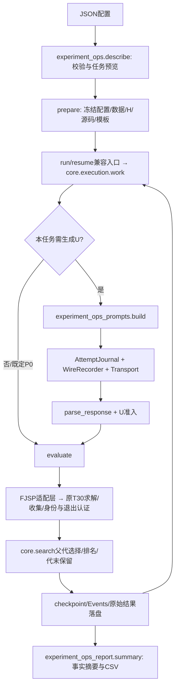

# 实验代码地图：从操作命令找到实现

面向会写Python、首次进入本工作区的使用者。只想配置并运行实验，先看[实验操作指南](实验操作指南.md)；项目入口见[项目使用说明](../项目使用说明.md)。统一命令入口是[manage.py](../experiments/tier2/manage.py)，旧实验控制器及其冻结资产全部保留。



## 最小可运行流程

[项目使用说明](../项目使用说明.md)中的`fixed-toy.json`不经过LLM：

1. `describe`读取已封存的真实10H；读取独立手写toy；用现有`load_instance`与`lower_bound_v5`获得实例身份和LB。这里只解析，不求解。
2. `candidate`将SELECT H0、H0/H1等权变为现有闭合U接口的候选；`prepare`保存解析后的配置、`Tasks.json`、H、输入副本、源码SHA、已加载函数身份、代码版本。
3. `tools/experiment_ops_run.py::work`是兼容入口，转到`code/heuristic_design/core/execution.py::work`。它按任务顺序经`FjspAdapter.evaluate`调用`code/heuristic_design/problems/fjsp/adapter.py::evaluate`；实际构造排程、逐列归一化、同分和复检仍由原组件实现。
4. `cross_feedback_ab_execute.worker`编译H/U，完成首解和复检；结果必须一致，再通过原T30收集器与`certify`认证。每个完整策略均在全部声明实例上评价，失败不得取前缀均值。
5. `work`先保存结果，再提交任务和预算；`summary`只读这些事实，生成`results/Summary.md`等。不调用模型解释结果。

独立生成和演化仅在第3步之前多出提示、API和准入。独立生成每次I1独立上下文，不读P0代码、旧输出或成绩。演化从**配置明确提供的P0代码**开始，在本数据上先认证P0，不自动调用LLM补满P0；一代内父代群体固定，代末保留`ranked(parents+valid_novel_children)[:N]`。

## 从终端命令找到代码

|你输入的操作|实际入口与主要调用|输入和输出|
|---|---|---|
|`check` / `plan`|`manage.py` → `experiment_ops.main` → `describe`|读取自己的JSON、H和数据，返回校验结果、任务列表和预算；不生成、不求解。|
|`prepare`|`experiment_ops.prepare`|输入配置和新目录；保存解析配置、任务、模板、文件哈希和prepared进度。|
|`run` / `resume`|`experiment_ops_run.start` → `core.execution.start/work`|先核对原身份、预算、锁和截止，再前台或后台执行。|
|生成一个U|`FjspAdapter.build_prompt` → `experiment_ops_prompts.build`；`AttemptJournal.request`|输入操作类型及父代，保存实际提示、尝试账本、原始响应。|
|提取并检查U|`FjspAdapter.parse_candidate` → `parse_response`，H01再经`h01.validate`|输入完整响应；输出合法候选或明确失败，不自动调用模型修复。|
|评价U|`FjspAdapter.evaluate` → 原`worker/collect/certify`|输入候选及完整实例清单；输出首解/复检、身份和完整Fitness或无效记录。|
|更新群体|`core.search.select_parents/ranked/survive`|读取当代群体，代末保存下一代和随机状态。|
|`status` / `summary`|`experiment_ops_report.status/summary`|只读原账本；可写新的事实摘要和CSV，不生成科研解释。|
|`stop`|`core.execution.stop`|写入暂停请求；当前候选完成并提交后才暂停。|

`core`表示通用执行部分，`adapter`表示问题适配层。FJSP的状态、H/U接口和求解规则在FJSP侧，不能为了调通通用任务执行而把它们混入通用核心。

## 我想改什么，应看哪里

|修改目标|配置/实际函数|边界|
|---|---|---|
|U初始化/独立生成|新接入点`tools/experiment_ops_prompts.py::build`的I1；H01原文在`tools/ind_evo_h01.py::independent_prompt`；10H原文在`tools/b1_usage_prompts.py::build_prompt`|可用新`prompt_overrides.I1`文件试新提示；不要改受冻旧文件。旧UsageWorkflow的SELECT-only INIT不是10H自由初始化。|
|CROSS|同一接入点的CROSS；H01委托`tools/h01_weight_search.py::build_prompt`，10H委托`tools/b1_usage_prompts.py::build_prompt`|H01原模板要求5父代，不可仅把配置改为2。新研究需新提示版本/新run。|
|MUTATE|同一接入点的MUTATE，以上两个模板构造器|原变异为1父代；默认不提供Fitness。|
|增加真实评价反馈|`code/fjsp_usage/cross_feedback_ab.py::feedback/render/validate_parent`；薄封装cross_ab分支|已实现的B仅加入两真实完整train21成绩和差值。H、数据、LB、代码不匹配就阻止，不补算父代。|
|P0代码与来源|配置`p0`；`experiment_ops.candidate`；`work`的p0分支|P0不是零成本；本封装无通用历史质量缓存导入，不偷用历史冠军分数。|
|父代选择|当前通用入口：`code/heuristic_design/core/search.py::select_parents`；调用点`core/execution.py::work`|排名权重1/(N+rank)、无放回；旧`research/evolution.py`是历史来源，当前入口不再直接从那里调用。改算法须新版本/新实验。|
|种群保留|`code/heuristic_design/core/search.py::ranked/survive`；`core/execution.py::work`的`last_gen_task`分支|按Fitness和稳定ID；代内不即时更新。旧`research/sets.py`保留为历史来源。部分代的已见冠军不等于已进入下一代。|
|换H/成员范围|配置`H_source`、`space`；`describe`/`checked_candidate`/`check_seal`|本封装只接已封存、编号0–9的10H。h01只允许H0/H1互补权重；ten_h允许全部成员SELECT/MIX。不会自动生成或审查新H。|
|换数据|配置`dataset.files`或`dataset.protocol`；`describe`|解析、复制、算LB并冻结。确认数据不能进入API搜索；改变清单或源文件不能恢复旧run。|
|U状态定义|`code/fjsp_usage/offline_v2.py::_SchedulingState.features`|七维输入是接口/科学条件，不能作为普通配置改动；需新协议和比较设计。|
|动作级特征/动作选择|`code/fjsp_usage/usage_v2/execution.py::construct_usage_schedule`|H看动作的7个原始特征；U看排程状态。修改会影响所有冻结H的含义。|
|评分归一化/同分|同文件`decode_output/normalize_scores/combine_scores`及动作argmax|单成员原始分数；双成员各列min-max、常量列0；精确动作同分按job/machine。是冻结科学语义。|
|下界LB/适应度Fitness|`offline_v2.lower_bound_v5`；`code/heuristic_design/problems/fjsp/adapter.py::evaluate`；原认证worker|未取整V5 LB，完整实例平均−Cmax/LB。不得以总Cmax或成功子集替代。|
|超时/退出认证|`code/fjsp_usage/baseline_supplemental/lifecycle.py::collect/classify`；`cross_feedback_ab_execute.certify`|T30完整实例回传和另2秒正常退出等待；新封装不允许JSON随意改期限。|
|重试/API计数|`code/heuristic_design/llm/legacy.py`桥接`research_real/attempt_budget.py::AttemptJournal`和`real_transport.py::JsonCandidateTransport`|候选与尝试分别计；已完整返回不重生；未知请求停止；短暂503至多按配置2次，连续3逻辑失败保护停止。|
|停止/恢复|`code/heuristic_design/core/execution.py::stop/start/ledger/work`；`tools/experiment_ops_run.py`仅作兼容入口|候选提交后暂停；原时窗/预算不重置；不删未知锁，不把断电当安全暂停。|
|摘要/表格|`tools/experiment_ops_report.py::summary`|本地确定性事实；无需API。报告呈现修改不改变评分或历史结果。|

## 两种“七维”不能混淆

U收到：`progress, candidate_pair_ratio, remaining_work_mean, remaining_work_std, machine_ready_mean, machine_ready_std, previous_heuristic`。进度是已调度工序数/总工序数；工作和机器量以`time_scale`归一化；它不是实际时间的完工比例。

H对每个合法动作收到：加工时长、作业剩余最短工作量、剩余工序数、作业就绪、机器就绪、该动作开始与结束时间。H输出动作优先级；U输出成员选择分数或权重。U没有动作列表和H当前打分，不能调用H。

SELECT是`(0, 十个有限选择分数)`；MIX是`(1, 十个非负权重)`，恰好1或2个正项。H01额外限制为`(1, (alpha, 1-alpha, 0,...,0))`，alpha在[0,1]。这两个空间并不相同。

## 审阅文件差异

先查看`git status --short`。`diff`就是“差异”，例如：

```sh
git diff -- experiments/tier2/ops tools/experiment_ops_prompts.py
git diff -- code/heuristic_design/core/execution.py code/heuristic_design/core/search.py
git diff -- code/heuristic_design/problems/fjsp/adapter.py
```

第一条看配置/提示改动，第二条看执行与选择，第三条看FJSP适配。只看`tools/experiment_ops_run.py`已不足以审阅当前执行逻辑，因为它现在是兼容层。新增未跟踪文件不会显示在普通git diff中，可用`git diff --no-index /dev/null 新文件路径`审阅（返回1表示有差异），或只对自己的文件使用git add -N再git diff。不要`git add .`混入别的任务。

任何会影响候选、提示、种群、H、数据或评价的修改都要新run身份；旧目录不就地改协议。旧H编号有训练排名信息，本封装不重编号。Tier1和其他工作树的运行能力没有在本交接中重新验收。

## 通用组件与历史实现的边界

2026-10-26完成通用边界抽取。`tools/experiment_ops_run.py`现在是兼容层，调用`heuristic_design.core.execution`，通过`heuristic_design.problems.fjsp.adapter.FjspAdapter`获取提示、准入和原T30评价。通用排名与生存位于`core/search.py`，结构接口在`core/adapter.py`。已有历史`research/evolution.py`等保持字节不变，避免重写冻结身份。API落盘/重试经`heuristic_design.llm.legacy`桥接原组件；Python包无需整体改名。

FJSP语义回归见[抽取报告](../reports/generic-extraction-20261026-v1/REPORT_ZH.md)，TSP后续严格按[固定协议](TSP_PILOT_PROTOCOL_V1.md)。

## 2026-10-27：问题边界与旧路径

[多问题结构与迁移说明](多问题结构与迁移说明.md)列出完整映射。`experiments/manage.py --problem fjsp|tsp`只分发；FJSP问题入口为`experiments/fjsp/manage.py`，仍委托原操作CLI。`problems/fjsp/{states,policies,solver,data,prompts,evaluation}.py`导出已有函数，函数身份不变；实际科学实现仍在旧路径。TSP在`problems/tsp/`，采用自身五输入状态、构造游程与NN参照指标，不套用FJSP七输入/LB。

共享core只处理任务/父代/种群/预算/记录/恢复，FJSP原T30认证仍在FJSP适配器，TSP使用已有独立生命周期。`fjsp/provenance.py::relocated_snapshot_source`只把历史冻结快照的相对路径映射到Developer副本，原回执不改且仍核对两份SHA；不是任意忽略绝对路径或身份。

## 状态schema边界

`core/state_contracts.py`注册legacy元数据、禁用共同状态草案，并提供未来新协议的显式cache绑定工具。`experiments/manage.py`在分发前检查问题/schema；没有替换原在线状态或旧缓存。字段定义、开销和未落实部分见[通用状态接口设计V1](通用状态接口设计V1.md)。改状态语义要新候选ABI、Prompt、协议、缓存和checkpoint，不能只改七维字段名。


## 最新TSP集成

最新c3b74b7成果通过ProblemAdapter复用原core，五输入、游程、MIX与NN评价不变。历史查看由`experiments/tsp/inspect_archive.py`独立只读处理，不重绑旧checkpoint。具体目录、入口及验证见[TSP最新成果迁移与接入](TSP最新成果迁移与接入.md)。

## 本地项目名称与路径

项目展示名和当前开发目录统一为Heuristic-Design-Lab。Python命名空间、算法、状态和原协议不变；公共Git仍在Developer的FJSP-Heuristic-Research/.git，环境仍链接h-usage-space/.venv。旧报告绝对路径保留，活动路径和显式vault用法见[本地工作区更名说明](本地工作区更名说明.md)。
