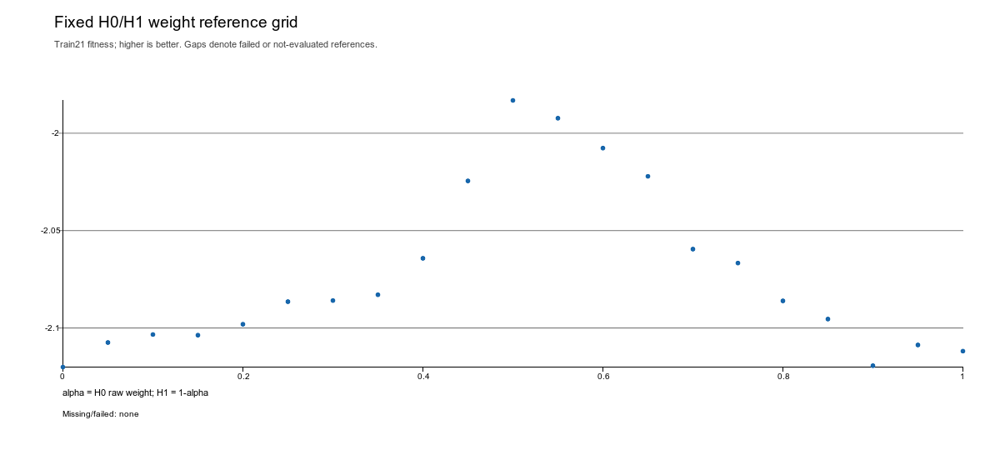
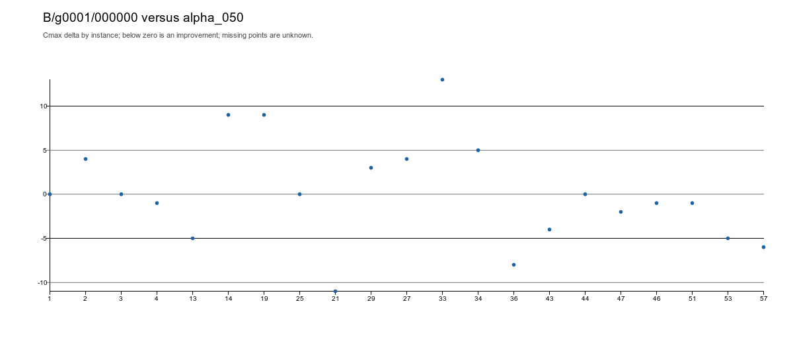

# B2-1 完整结果索引

阶段B–E已完成；固定H0/H1、seed501、21train、两代N=5，未使用validation/test。

新动态冠军 `B/g0001/000000`：Fitness **−1.982226488242**，人工等权及21点静态网格冠军为 **−1.983144294915**。训练内平均Cmax/LB降低约 **0.0463%**，逐实例10胜7负4平。没有新的常量U冠军。

20个逻辑任务、20次API尝试、19个有效新U、1个重复；无重试、接口／评价失败或pending。16个新静态点及19个新U共35次完整训练评价。未因结果追加请求或评价。

- [完整中文报告与冠军源码](B2_1_REPORT_ZH.md)
- [全部21个静态点与19个有效新U](Candidates.csv)
- [全部逐实例makespan与score](Instances.csv)
- [逐实例LB、计时、h调用与权重范围](Instance_costs.csv)
- [与等权／静态网格冠军逐实例比较](Comparisons.csv)、[胜负平](Win_loss_tie.csv)
- [P0／P1／P2全部成员](Population_members.csv)、[每代最佳与均值](Generations.csv)
- [20个槽位完整父子谱系](Lineage.csv)、[逻辑请求](Requests.csv)、[API尝试](API_attempts.csv)
- [最佳动态U实际源码](sources/B_g0001_000000.py)、[全部静态及模型候选源码](sources/)
- [源码不同但物理排程相同的观察分组](Observed_physical_groups.json)
- [请求、种群、Prompt及成本审计](Execution_audit.json)
- [全部原始结果哈希](Original_result_hashes.json)、[压缩备份核验](Backup_manifest.json)
- [完整原始运行备份（含评价、物理排程与checkpoint）](evidence/B2_1_raw_run_backup.tar.gz)
- [配置、实际Prompt、完整响应、原始API日志与事件](evidence/)





保留矢量原图：[静态网格](Fixed_weight_curve.svg)、[逐实例差值](Best_new_vs_alpha_050.svg)。差值为新U减等权，负值表示改善。

计时是求解／复检墙钟秒，不是CPU进程秒。缓存固定h端点不含U接口开销；费用unknown/null，不查询账户或账单。原始账单及凭证文件未上传。

本结果仅支持本批训练条件下的新动态程序及跨代继承证据；不证明泛化、超过全部可能常量权重或动态性本身的因果收益。下一步建议冻结冠军与等权，在另行登记的独立数据上配对复验；本轮未执行。

派生分析脚本 `build_execution_analysis.py` 只读取已保存结果，不含API请求、训练求解或轨迹回放。依赖本项目原冻结资产和原准备目录；备份不包含训练数据文件或密钥。

```bash
PYTHONDONTWRITEBYTECODE=1 PYTHONPATH=code:tests:. .venv/bin/python -B \
  reports/h01-state-weight-search-seed501-batch-v3-20261020/build_execution_analysis.py
```

**本批正式实验已结束，不再运行grid/search。** 原运行入口为 `tools/h01_weight_local.py`，本轮未改任何生产代码或冻结科研输入。
