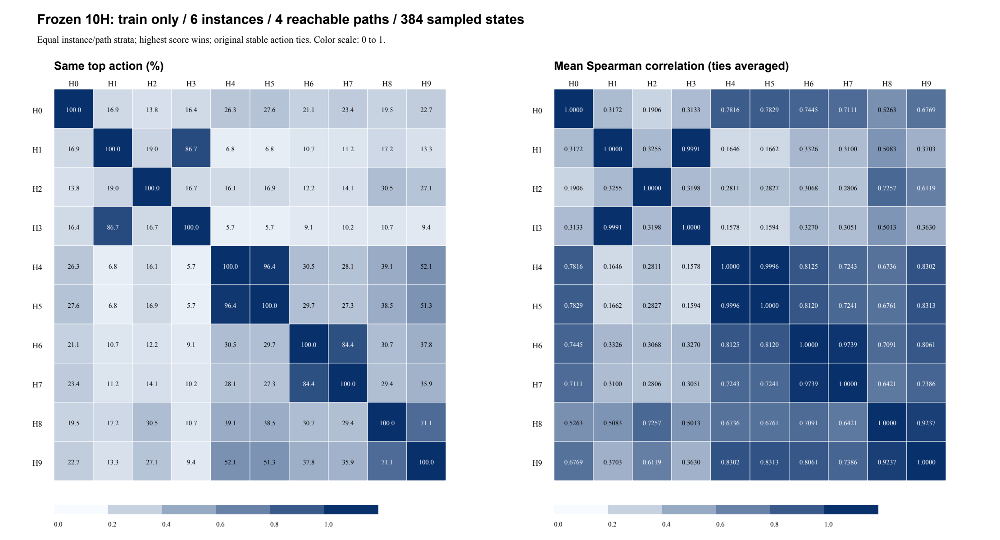
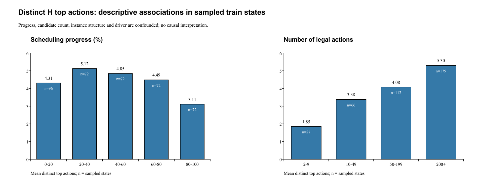

# 固定10H决策多样性诊断 V1

**在本次384个可达状态中，10H具有明显但不均匀的行为差异：平均产生4.37个不同首选，最多8个；H4/H5最接近。现有数据不能判定Kmax=2是收益瓶颈，也不能证明更大K或扩展U状态会更好。**

## 前提与范围

原生 `usage_v2/execution.py` 已有完整合法动作枚举和只读trace入口。U每步先输出，执行器对全部当前合法动作评分，再按最大值和稳定枚举次序选动作；trace虽在提交后回调，保存的是提交前状态。本工具只在独立镜像中恢复这个状态，旁路评分不向原执行器提供动作。动作集合指**现有追加式构造器允许的全部“未完成作业下一工序×可选机器”**，不包含插空等其他调度动作。

H0/H1各对6个实例进行一次原生端点回放（复用既有alpha=1/0源码，不生成U），并与历史固定h完整Schedule哈希核对。B3/B5复用已保存的逐步动作，逐步检查合法性、七状态、U输出、动作数、行为哈希，最终重建的完整UsageResultV2哈希匹配原主评价。**24条路径全部通过**；B3/B5没有重新完整求解。观察器只在预定抽样步计算10H；所有样本原driver动作均匹配原生argmax/组合规则。

先读取21train结构，再用预定最远点覆盖规则选6个实例，规则与来源哈希在[Plan.json](Plan.json)，不使用策略成绩选样本。特征为log作业数/机器数/工序数、柔性、名义最大负荷份额；初始为最大工序数、同分按manifest顺序。名义负荷是各工序向候选机器均分的加工时间代理，**不是实际排程负荷**。这是有限结构覆盖，不是随机代表整个问题族；未覆盖全部训练结构极值。

| 实例 | J/M/Q | 柔性：平均候选机器数/M | 名义最大负荷份额 |
| --- | --- | --- | --- |
| Behnke19.fjsp | 100/20/500 | 0.322 | 0.054 |
| Behnke43.fjsp | 10/60/50 | 0.321 | 0.052 |
| Behnke3.fjsp | 10/20/50 | 0.312 | 0.067 |
| Behnke53.fjsp | 50/60/250 | 0.311 | 0.056 |
| Behnke46.fjsp | 20/60/100 | 0.261 | 0.057 |
| Behnke29.fjsp | 20/40/100 | 0.349 | 0.057 |

每实例固定H0、H1、真实B3（成员对2/4或4/7）、真实B5（成员对0/9）四条路径，各取`floor(t*(Q−1)/15), t=0..15`，共384状态、364不同物理状态、每状态4–1056个合法动作。这样避免只观察H0路径；四条路径仍不是全部可达状态分布。重复物理状态保留在分层主分析中，另给去重敏感性结果。

只打开21个train文件；没有holdout读取、LLM/LeafAPI/账单查询、新H/U、权重搜索、正式fitness评价或原记录写入。没有修改生产调度器。原公式及裁剪由原编译器执行；首选精确同分按作业、机器枚举先后，排名相关性按同分平均秩计算，常量列应为未知。本次所有384状态的各列相关性均可定义。

## 10H相似性

主表是同态首选动作一致百分比，先在每个实例×driver内平均，再等权平均24个分层。完整相关矩阵见[图](H10_similarity.png)及[Spearman CSV](spearman_matrix.csv)。状态间相关且来自训练，下面不作独立样本显著性检验。

| %同首选 | H0 | H1 | H2 | H3 | H4 | H5 | H6 | H7 | H8 | H9 |
| --- | --- | --- | --- | --- | --- | --- | --- | --- | --- | --- |
| H0 | 100.0 | 16.9 | 13.8 | 16.4 | 26.3 | 27.6 | 21.1 | 23.4 | 19.5 | 22.7 |
| H1 | 16.9 | 100.0 | 19.0 | 86.7 | 6.8 | 6.8 | 10.7 | 11.2 | 17.2 | 13.3 |
| H2 | 13.8 | 19.0 | 100.0 | 16.7 | 16.1 | 16.9 | 12.2 | 14.1 | 30.5 | 27.1 |
| H3 | 16.4 | 86.7 | 16.7 | 100.0 | 5.7 | 5.7 | 9.1 | 10.2 | 10.7 | 9.4 |
| H4 | 26.3 | 6.8 | 16.1 | 5.7 | 100.0 | 96.4 | 30.5 | 28.1 | 39.1 | 52.1 |
| H5 | 27.6 | 6.8 | 16.9 | 5.7 | 96.4 | 100.0 | 29.7 | 27.3 | 38.5 | 51.3 |
| H6 | 21.1 | 10.7 | 12.2 | 9.1 | 30.5 | 29.7 | 100.0 | 84.4 | 30.7 | 37.8 |
| H7 | 23.4 | 11.2 | 14.1 | 10.2 | 28.1 | 27.3 | 84.4 | 100.0 | 29.4 | 35.9 |
| H8 | 19.5 | 17.2 | 30.5 | 10.7 | 39.1 | 38.5 | 30.7 | 29.4 | 100.0 | 71.1 |
| H9 | 22.7 | 13.3 | 27.1 | 9.4 | 52.1 | 51.3 | 37.8 | 35.9 | 71.1 | 100.0 |

| 成员对 | 首选相同 | Spearman | 不同首选：双向严格/涉及一方无差别 |
| --- | --- | --- | --- |
| H1/H3 | 86.72% | 0.999065 | 31/20 |
| H4/H5 | 96.35% | 0.999565 | 14/0 |
| H6/H7 | 84.38% | 0.973906 | 60/0 |
| H8/H9 | 71.09% | 0.923658 | 111/0 |

H4/H5只有14/384个首选不同，且均为不同作业间的严格偏好翻转；H4比H5多一个依赖工序数和剩余工作的depth_bonus，整体排名极近也可能翻转头部。H1/H3有51个首选不同，其中20个涉及一方对两个动作同分，31个为双方严格偏好相反；16个差异仅换同一工序的机器。未丢弃这些同分造成的实际差异，也未把它们全部解释为强冲突。

在未触发裁剪的合法输入下，H1的估计量为`finish+w−w/n`，H3为`finish+w−min(p,w/n)`；H3会在`p<w/n`时抵消finish中的当前加工时间，造成某些机器同分。因此Spearman达0.999065仍不等于首选相同。H6/H7首选一致84.38%，H8/H9只有71.09%，后者不能仅因公式相似就当作等价成员。

H0/H1首选一致仅16.93%、Spearman约0.317；H1/H4与H3/H4也很不同（首选一致6.77%/5.73%），H2相对H0及H6同样不同。这些是可利用信息存在的候选线索，不是组合收益排名。

去重后H1/H3、H4/H5、H6/H7、H8/H9一致率分别86.26%、96.15%、84.62%、69.78%，与主表判断相近；排除不足10个动作的状态后分别85.62%、96.05%、84.54%、70.08%。不能根据近邻结果直接删除成员：单选首选相似不保证与第三条h组合后的min–max分数几何相同。组合还取决于归一化后的数值间距，仅凭排名相关性不能判断成员可互换。

## 状态、路径与真实动作例子

H0、H1、B3、B5路径的平均不同首选数分别4.47、3.28、4.77、4.97，说明只采H0会漏掉部分路径行为。进度20–40%平均5.125种、80–100%为3.11种；2–9个候选动作时为1.85种，200个以上为5.30种。**进度、动作数、实例结构、driver相互混杂**，不能解释为进度导致分歧或大实例更有组合收益。逐实例与各分层见[Metrics.json](Metrics.json)。

三个可核查例子（编号从0开始，完整10H前三排名、原分数和七状态见[代表状态](Representative_states.md)；压缩原始文件保留全部动作、输入、分数、秩）：

- `Behnke3/H1/step45`：12个动作，H1选(job1,op3,m14)，H3选(job1,op3,m9)。H3对m9/m13/m14同分，按机器编号选m9；H1对m14严格更偏好。
- `Behnke43/H1/step9`：36个动作，H4选(job8,op0,m3)，分数28.768743；H5选(job2,op0,m3)，分数26.8125。不同H的原始分数不能直接跨列比较大小。
- `Behnke3/B3/step42`：B3实际以H4/H7权重0.602181/0.397819，选(job6,op4,m19,start79,end92)。该动作在H4/H7平均秩为2.5/2，**不是任何一条H的单独首选**。这是组合改变动作的直接行为证据，后续收益未知。

## 当前MIX利用了什么，尚不能说明什么

将已有B3/B5直接应用于全部384个共同状态（七状态及previous_heuristic来自原driver，不另滚动影子策略历史）：B3有95/384步、B5有72/384步选择了两个组成成员各自首选之外的动作；其中46/384、36/384步不是任何10H单独首选。在它们自己的96个抽样状态中，后一个计数分别24、21。这里首选包含原同分规则；更严口径下，所选动作严格低于两个组成成员各自最高分的计数为91/384、69/384，严格低于全部10H各自最高分的计数为42/384、32/384（其余可能涉及打破同分，见[Tie_sensitivity.json](Tie_sensitivity.json)）。B3/B5同态首选相同54.17%；全部共同策略一致率见[CSV](Common_state_policy_agreement.csv)。这些数字说明组合不是简单挑一个h，但不能说明折中动作更好。

完整排程性能只复用原21train：H0=−2.111805、B3=−2.424245、B5=−2.329617，两个真实动态组合都低于H0。另经H身份、train和执行语义绑定核对，既有H0/H1等权手工网格结果为-1.983144，高于H0；来源为`reports/usage-fixed-pair-weight-grid-20261018-v1/results/H0_H1_w50_50.json`，本轮未重评。这支持优先理解H0/H1这一已有训练获益的简单组合，不支持“分歧越大越好”，也不是独立验证或本轮LLM收益。单步排名和完整fitness不能互作正确成员标签。

## 科研判断与下一步

1. **10H确有明显排序差异，也有近似冗余**：优先区分H4/H5的细微头部翻转与H0/H1等跨偏好差异。保留公式、具体状态和同分机制，不能只按源码相似度划类。
2. **还没有证据表明两成员限制是明显瓶颈**。某状态有8个不同首选，不代表必须同时混8条；现有U本来可逐步从10条任选成员/成员对，两条也已能产生单h首选之外的动作。缺少“第三条评分对最终质量的边际价值”证据。
3. **目前不建议直接扩大到Kmax=2/3/5搜索**。先以H0/H1已有基线和冻结U补足成员选择/权重机制证据；若之后检验K，先做独立登记的2对3小对照，控制成员来源、初始策略、评价及计算预算，再决定是否加入5。本轮不修改接口、不执行该比较。
4. **七状态可能不足，但当前不能定论**。U只有进度、候选对数量比例、剩余工作均值/标准差、机器ready均值/标准差及上一主导成员，看不到当前合法动作及10H的分数/排名冲突。聚合量丢失了作业—机器对应信息，可能限制对分歧的感知；本样本未发现七输入完全相同而物理状态不同的精确碰撞，也不能由此证明七状态充分。尚缺与最终收益相关、受控且可部署的感知验证；本轮不扩展状态。

未解决：未采轨迹/实例能否保持上述相似性；微小排序翻转如何累积为排程变化；MIX折中何时带来收益或损害；动态权重相对合适常量是否有增益；增加成员的质量收益能否抵消评分成本；七状态对这些条件是否足够。均没有状态级正确成员标签或泛化/因果收益结论。

## 成本、核验与复现

原生H0/H1共12遍有限回放，新增原生h评分625,892次；样本旁路10H评分919,080次；本地诊断约20.20秒。时间包含镜像、旁路打分、压缩和统计，不是求解器速度比较，没有新增确定性复检或候选有效性判定。24条路径哈希全部匹配、全部输入pins前后不变；离线检查覆盖同分秩、常量相关性未知、动作数量和非法提交拒绝。未修改历史有效性、期限、checkpoint、资产或账本。

原采集命令：`PYTHONDONTWRITEBYTECODE=1 PYTHONPATH=code .venv/bin/python -B tools/diagnose_h_decision_diversity.py`（目录已存在会拒绝重跑）；`--check`仅做离线前提检查、不求解。`render_report.py`仅读取派生诊断及已说明的旧网格参照，使用预装ReportLab生成表图，不运行调度器。已有计划、完整样本、路径核对、CSV与Completion共同构成本次证据；不要把本次局部观察当成新的训练搜索或独立验证。
