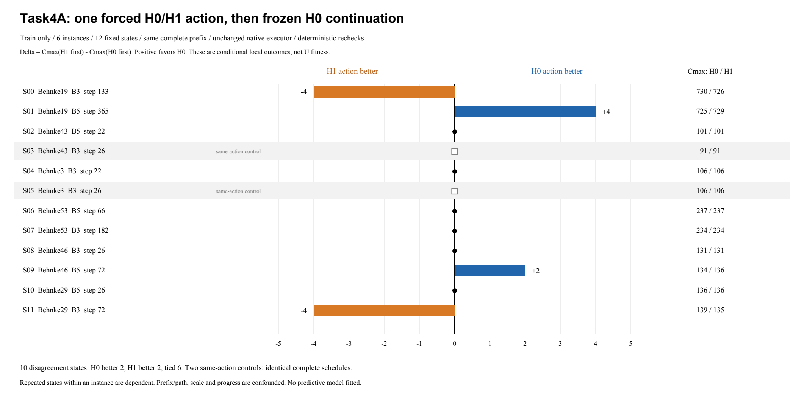

# 任务4A：七维状态的信息价值与受控续排诊断 V1

**在10个预先固定的动作分歧状态中，H0/H1首步选择造成4个非零最终Cmax差异，双方各好2次、另6次相同；同一实例出现优势方向反转。七维状态存在候选关联线索，但样本不足以判断可预测性，更不足以认定需要扩展状态。** 这些结果只对“随后固定H0续排”的条件问题成立，不能解释为动态U整体性能提升。

## 前提检查

1. **完整状态可恢复**：B3/B5真实历史记录保留逐步动作(job/op/machine/start/end)、输出、主导成员和七状态；结合原训练实例，可重建完整已排工序、作业游标、job/machine ready、剩余工时后缀、时间/候选数尺度及全部成员历史，不只恢复七维摘要。12个冻结快照与原记录、缓存完整动作集合及动作输入逐项一致。
2. **可强制同态首步**：现有构造器没有公开“从部分状态起跑”参数。本轮不改它，而是由可信诊断控制器向原生执行器逐步返回原历史输出，原样重放前缀；在指定步强制SELECT H0或H1，再统一SELECT H0。完整前缀逐动作核对，强制动作匹配缓存首选。控制器是测试夹具，不是生成、登记或入池的U。
3. **续排规则完全相同**：两个分支后续都是冻结H0、原始h动作分数、追加式调度、原同分顺序；previous_heuristic由原执行器正常更新。H0不读取该历史标签；无分歧对照虽首步标签不同，仍应得到完全相同的物理排程。
4. **选择不看成绩**：只用上一轮既定6个训练实例和B3/B5轨迹，从原384状态池的192个B轨迹状态中筛选；要求非首步、至少10个合法动作。先按距进度0.5最近选择两个不同实例的无分歧对照；这些实例各取一个近0.5分歧状态，其余实例各取近0.25/0.75的分歧状态，路径B3/B5按固定顺序交替。规则、全部状态身份与源码/资产/实例哈希在求解前写入[Plan.json](Plan.json)，没有按观察结果换样本、换续排或追加尝试。对照也并非随机样本。
5. **数据隔离**：仅原6个train文件；没有validation/test、LLM/LeafAPI、新H/U、Tier1或生产执行器修改。结果在新目录，原run、资产、配置和历史报告不写入。
6. **15秒边界可行，但有紧张样本**：每个状态的两分支各一次主求解及复检，共4遍构造，**合计共享**原`runtime._collect`的15秒进程期限，比每分支各15秒更严格。12对全部完成，最慢14.701秒；不支持据此扩展更大状态或自动加时。另有Behnke3上的2遍原生身份核对，共享单独15秒，均匹配历史哈希；非法起始时间/工序的反例被拒绝，变更快照被哈希检出。

## 全部配对结果

两个分支共用同一完整前缀，区别只有指定步选H0还是H1，其后都用H0。Δ>0表示该状态下H0动作更好，Δ<0表示H1动作更好。这里没有新的U fitness；score/LB继续使用原不取整V5口径。

| 状态 | 实例/路径 | 进度 | 首选是否不同 | H0首步后Cmax | H1首步后Cmax | Δ=H1−H0 |
| --- | --- | --- | --- | --- | --- | --- |
| S00 | Behnke19/B3 | 0.266 | 是 | 730 | 726 | -4 |
| S01 | Behnke19/B5 | 0.730 | 是 | 725 | 729 | 4 |
| S02 | Behnke43/B5 | 0.440 | 是 | 101 | 101 | 0 |
| S03 | Behnke43/B3 | 0.520 | 否（对照） | 91 | 91 | 0 |
| S04 | Behnke3/B3 | 0.440 | 是 | 106 | 106 | 0 |
| S05 | Behnke3/B3 | 0.520 | 否（对照） | 106 | 106 | 0 |
| S06 | Behnke53/B5 | 0.264 | 是 | 237 | 237 | 0 |
| S07 | Behnke53/B3 | 0.728 | 是 | 234 | 234 | 0 |
| S08 | Behnke46/B3 | 0.260 | 是 | 131 | 131 | 0 |
| S09 | Behnke46/B5 | 0.720 | 是 | 134 | 136 | 2 |
| S10 | Behnke29/B5 | 0.260 | 是 | 136 | 136 | 0 |
| S11 | Behnke29/B3 | 0.720 | 是 | 139 | 135 | -4 |

非零差异为−4、+4、+2、−4个时间单位；相对各对较优Cmax约0.55%、0.55%、1.49%、2.96%。它们是通过复检的真实有限差异，不能称为稳定或广泛的收益。两个同首选对照的完整排程相同。

6个“不同动作但Cmax相同”状态中，5个最终**物理排程也相同**（按job/op/machine/start/end排序，忽略提交次序）；S07则是物理排程不同但Cmax相同。因此动作排序差异可能只改变可交换的提交顺序，也可能改变排程而不改变当前目标，不能从首选分歧率直接推出收益空间大小。

Behnke19的S00（进度0.266、B3前缀）H1好4，S01（进度0.730、B5前缀）H0好4：**优势不是总朝同一方向**。但状态、来源路径及进度同时变化，这不构成“早期选H1、晚期选H0”的规律。其余实例的平局与退化全部保留，未从表中排除。

## 七维状态是否有关联信号

按预先指定的分析，对10个分歧状态全部六个连续输入与Δ/LB计算描述性Spearman；平局使用平均秩，不做p值、特征选择或预测器拟合：

| 七维输入的连续分量 | Spearman(该特征, Δ/LB) |
| --- | --- |
| progress | +0.289 |
| candidate_pair_ratio | -0.328 |
| remaining_work_mean | -0.157 |
| remaining_work_std | +0.014 |
| machine_ready_mean | +0.116 |
| machine_ready_std | -0.205 |

连续特征的样本相关性均较弱（绝对值不超过0.328），既不能证明有预测价值，也不能证明无信息。progress<0.5的6个状态为H1好1/平5；progress≥0.5的4个状态为H0好2/H1好1/平1，显然不是确定的阶段规则。

`previous_heuristic`按类别处理，不能用编号大小解释质量：

- 上一成员H4的5个分歧状态：H1好2、平3；它们全部来自B3。
- 上一成员H0的4个状态：H0好2、平2；上一成员H9的1个状态为平；这5个状态全部来自B5。

这提示现有七维中的历史类别可能携带路径信息，但与B3/B5前缀来源完全混杂，且非零结果只有4个。不能将其归因于历史特征本身，更不能声称已有可部署选择器。工序规模、时间归一化尺度、进度和完整作业—机器结构也混杂在这些聚合输入中。

## 科研判断

- **可比的局部后续质量存在**：在本轮固定续排定义下，4/10个分歧状态产生可重复的非零Cmax差异；幅度有限，其他状态不能忽略。
- **选择优势有状态/路径依赖现象**，同一实例已有反向例子；还不能识别决定方向的因素。
- **七维可预测性：证据不足**。只有10个分歧状态、6个训练实例，其中4个实例重复取状态；步骤不是独立样本。采样仅覆盖既有B3/B5路径，且针对动作分歧和指定进度，不能估计整个可达状态分布中的优势频率。没有独立组验证，未估计泛化误差，不能用小样本拟合后的成绩支持信息价值。
- **目前没有立即扩展U状态的依据**：既没有证明七维足够，也没有证明它缺少关键可预测信息。先保持接口，按实例分组补充预先固定的受控证据；如未来检查续排敏感性，必须独立登记H1等另一冻结续排，不能用本轮结果临时替换H0重跑。当前结果不是通用“正确成员”标签，也不是动态U收益。

## 成本、复现与证据

完成12对×4遍=48遍配对构造，另2遍原生身份核对，共50遍；全部无超时、无重试。配对父进程墙钟合计48.127秒；身份核对耗时未单列，不能把这当作整个任务总时间。配对认证h评分5,814,128次，身份核对8,196次；配对中约71.0%调用用于**重复前缀以复用原生执行器**，不是从部分状态直接起跑的理想成本。计时含观察核验/输出开销，资源未独占，不作精确速度比较。

- [Paired_results.csv](Paired_results.csv)：12行全部结果、七维输入、动作、物理排程比较及成本。
- [states/](states/)：冻结的完整快照、原前缀输出/动作、状态哈希；[results/](results/)保留两分支完整排程、主求解与复检哈希、分阶段h调用。
- [Native_reference_checks.json](Native_reference_checks.json)：H0原排程及B3完整原生结果哈希复现；[Completion.json](Completion.json)、[Evaluation_costs.csv](Evaluation_costs.csv)、[Analysis.json](Analysis.json)记录完整性、失败边界、全部关联结果。
- [diagnose.py](diagnose.py)仅本目录诊断控制；[analyze_results.py](analyze_results.py)及[render_report.py](render_report.py)仅读派生结果。生产核心源码哈希与旧协议保持一致。

原执行命令（仓库根，`.venv`）：`PYTHONDONTWRITEBYTECODE=1 PYTHONPATH=code:. .venv/bin/python -B reports/task4a-state-information-v1-20261020/diagnose.py prepare`，随后同入口`run`。prepare只冻结/核验，run实际本地求解。目录已有启动标记，拒绝自动重跑。后处理入口为同目录`analyze_results.py`；绘图用预装ReportLab运行`render_report.py`，不启动求解。**本批已完成，不追加状态、续排规则或实验。**
