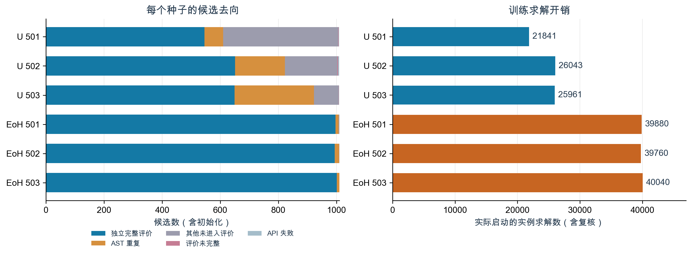
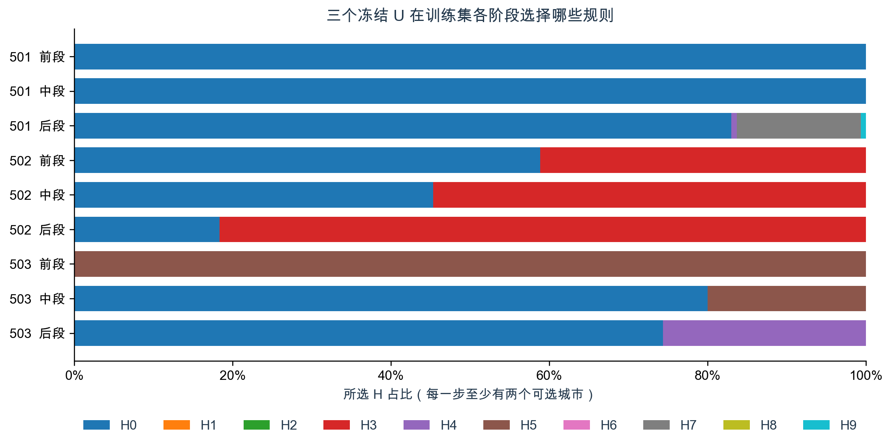
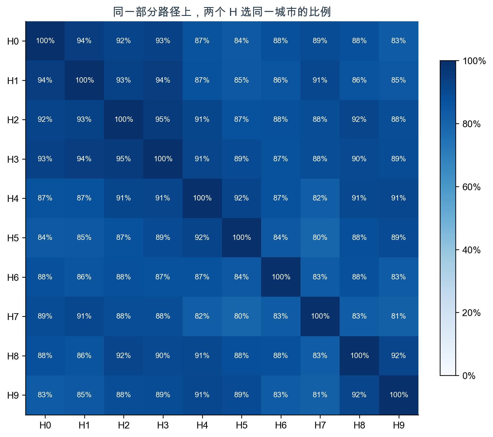

# TSP 双层 U 表现不足的机制诊断

2026 年 11 月 26 日。比较围绕 U 能否通过逐步换规则获得更好的路线展开。候选统计来自六份正式训练归档。路由复算只使用 train20 和三个原样冻结的 U 冠军。(J) 为相对 LKH 参考路线长度的平均差距，越小越好。

## 观察到的证据

### 1. Best Fixed H 补齐了哪一项对照

核验了现有记录。10 条 H 先在训练 20 例上独立评价，**H0 以训练 J 最低入选**。随后把冻结的 H0 放到九个冠军用过的同一批 confirm60 实例上，逐例核对了 LKH 分母。

| 方法 | 训练 J | confirm60 J |
| --- | ---: | ---: |
| U，三种子均值 | 9.58% | 12.14% |
| EoH，三种子均值 | 8.90% | 10.76% |
| Ross-style，三种子均值 | 9.49% | 12.04% |
| Best Fixed H（H0） | 10.87% | 11.57% |

U 相对 H0 的训练均值低 **1.29 个百分点**，confirm60 均值高 **0.57 个百分点**。以三次 U 的逐实例平均成绩与 H0 配对，U 在 **24 例更好、35 例更差、1 例持平**。EoH 的三种子外评均值最低，领先 U **1.38 个百分点**。

**评价集用途记录。** 本次已将 confirm60 的既有成绩和配对胜负纳入改进诊断。本轮的新路线求解全部在 train20 上。今后若参考这份诊断修改 U，confirm60 应视为已参与开发分析的基准，改进版的独立确认需使用预先登记的新实例。

### 2. 训练求解次数为何更少

六个种子各收到 **1000 个成功返回的演化候选**。其中能得出有效训练分数的数量，U 三个种子分别为 541、646、644，EoH 为 997、999、1000。

| 方法／种子 | 有效程序，含初始化 | AST 重复 | 其他未入评 | 评价未完整 | API 失败 | 独立完整评价 | 实际求解启动 | 严格刷新最佳 J |
| --- | ---: | ---: | ---: | ---: | ---: | ---: | ---: | ---: |
| U 501 | 546 | 64 | 396 | 1 | 2 | 546 | 21,841 | 2 |
| U 502 | 651 | 172 | 180 | 3 | 3 | 651 | 26,043 | 8 |
| U 503 | 649 | 274 | 84 | 1 | 1 | 649 | 25,961 | 7 |
| EoH 501 | 1007 | 10 | 3 | 0 | 0 | 997 | 39,880 | 18 |
| EoH 502 | 1009 | 15 | 1 | 0 | 0 | 994 | 39,760 | 10 |
| EoH 503 | 1010 | 9 | 0 | 0 | 0 | 1001 | 40,040 | 19 |

计数均含初始化，最后一列只统计演化期间严格下降的更新。AST 重复指程序的语法结构相同。U 丢弃重复候选。EoH 可以复用历史评价，所以有效程序数量包括复用结果。独立完整评价表示一个新程序完成 20 例首解和复核，共 40 次求解。「其他未入评」为总账中扣除重复、启动过评价和报告的 API 失败后余下的数量。按运行器路径，这一项主要对应解析或约束校验，现有归档未保存逐条报错文本。

U 共启动 **73,845** 次实例求解，EoH 为 **119,680** 次，U 少 **38.3%**。这里统计六次搜索，独立构建 H 库的成本另计。两者相差 1,146 次独立完整评估。对应的主要差额是 656 个其他未入评候选和 476 个重复候选。U 的 6 次 API 失败和 5 次未完成评价只解释其中一小部分。这个差距反映了有多少候选走到完整评价。

| U 种子 | 交叉刷新次数 | 变异刷新次数 | 训练 J 累计下降 | 最后一次刷新所处的成功候选序号 |
| --- | ---: | ---: | ---: | ---: |
| 501 | 2 | 0 | 0.043 个百分点 | 723 |
| 502 | 2 | 6 | 1.982 个百分点 | 473 |
| 503 | 3 | 4 | 1.840 个百分点 | 542 |

变异贡献了 17 次改进中的 10 次，三个种子的累计下降量中约 81% 来自变异。算子身份由冻结的交叉／变异交替顺序和训练冠军位置反查。三个冠军的位置都与成功返回序号对齐，因此在最后一次刷新之前，这些种子没有缺失的演化返回。EoH 的初始化最佳 J 约为 20.20%–24.67%，U 三个种子均为 10.87%，比较下降幅度时要考虑起点。



[印刷版图 1](01-search-efficiency.pdf) · [候选汇总](candidate-accounting.csv) · [每次刷新明细](strict-improvements.csv)

### 3. 冻结 U 到底换了什么

回放 3×20 条原始训练路线，重现了三个训练冠军的 J。记录了 2,940 步。下表只统计至少有两个合法下一城市的 2,880 步，每种子 960 步。「与 H0 不同」是在同一条 U 部分路径上，比较 U 实际选的城市与 H0 此时会选的城市。

| 种子 | 实际使用的 H 数 | 使用最多的规则及占比 | 相邻步换规则 | 与 H0 不同的选城 |
| --- | ---: | --- | ---: | ---: |
| 501 | 4 | H0，占 94.7% | 2.1% | 1/960，0.1% |
| 502 | 2 | H3，占 58.3% | 64.5% | 45/960，4.7% |
| 503 | 3 | H0，占 49.9% | 8.9% | 63/960，6.6% |

501 的前、中段全用 H0，后段的少量切换只改了一个实际动作。502 在 H0 和 H3 间频繁切换，并使用进度、近期增量和使用次数等信息。503 主要沿进度从 H5 切到 H0，再切到 H4，历史信息可改变少数过渡决策。把 20 个实例按同一个选城序号对齐，有不同规则出现的位置分别为 **10/48、10/48、4/48**。这比只看 H 的使用占比更能说明规则选择何时随实例变化。



[印刷版图 2](02-routing-by-phase.pdf) · [逐实例回放](routing-per-instance.csv) · [规则选择汇总](routing-summary.csv) · [实际读取的状态字段](routing-state-reads.csv) · 逐步记录见本机归档 `r15-consolidation-20261127/routing-trace-train20.jsonl.gz`

### 4. 十条 H 有多互补

在同样的 2,880 个 U 部分路径状态上，把 10 条 H 分别代入同一个合法城市集合，仅记录它们会选哪座城市。**1,987 步（69.0%）十条规则全部同选一城**。其余 893 步中，有 754 步只有两个不同动作，U 实际选择了与 H0 不同的城市 109 次，占这些可改变动作状态的 12.2%。45 对不同 H 的选城一致率平均 **88.1%**，范围 **79.5%–95.5%**。502 常切换的 H0 和 H3，在 **502 自己的路线状态上**也有 **92.4%** 的动作一致率。原路线构造照常执行每步选中的 H，替代规则打分只用于事后诊断。

整条路线层面仍有互补性。若在训练的每个实例上，事后从十条固定规则完成的十条路线里挑最短的一条，平均 J 为 **5.45%**，低于处处用 H0 的 **10.87%**。这个数描述训练集上的事后选择空间，用来区分「规则有互补性」和「U 能用当下可见信息找到互补机会」。



[印刷版图 3](03-h-decision-agreement.pdf) · [逐种子规则配对](h-pair-agreement.csv) · [不同动作数量分布](h-decision-diversity.csv)

## 可能原因

- **搜索有效产出低。** 相同的成功返回预算下，U 得到的独立完整评价约为 EoH 的六成。未入评和结构重复占了主要差额，种子间的主导因素也不同。501 以未入评为主，503 以重复为主。
- **U 发现了切换模式，但改变动作的机会少。** 501 几乎复现 H0。502 虽然频繁换 H，常用的两条规则大多选同一座城市。503 的切换更像阶段规则。十条 H 在完整路线上的成绩有互补性，现有 U 只把其中一小部分转化成了逐步动作差异。

## 目前还不能确定什么

训练轨迹上的动作差异率不能量化换规则对外评差距的因果贡献。部分路径来自三个已训练的 U 冠军，十条 H 在别的状态上可能有不同的一致率。已有记录也不足以把未入评余项分到具体语法、字段或输出错误，或判断同等独立有效评价次数下 U 能否追上 EoH。三个种子的交叉与变异贡献只能说明这次实际发生了什么。

## 建议的新实验

1. **先拆开进度规则与实例状态的作用。** 固定十条 H，在预先登记的新实例上比较固定 H0、只读构造进度的规则切换、完整冻结 U。三者使用相同实例和 LKH 分母。先看完整 U 是否能稳定超过进度切换，再看超过 H0 的幅度。
2. **把候选可用率作为独立问题验证。** 保持规则库、状态、交叉和变异不变，仅验证候选生成的接口反馈能否提高解析通过率和去重后的完整评价数。并列报告同等 API 请求预算和同等独立完整评价数下的两种比较。
3. **最后单独检验 H 库的行为多样性。** 固定 U 搜索方法与 10 条规则的数量，比较现有库和按训练集动作差异与路线质量筛出的库。先预定筛选和新外评集合，再检查有意义的选城变化是否带来路线收益。

## 核对与复现

[核验数值和输入哈希](metrics.json) · [复算与绘图脚本](analyze.py)。输入使用六冠军归档、六条有序演化曲线、九冠军 confirm60 结果包和 Best Fixed H 结果包。数值复算沿用 Python 3.12，保留冻结程序的语法结构身份。绘图使用现有 Matplotlib 环境。

```bash
R="$HOME/Developer/Heuristic-Design-Lab-successful-runtime-20261119"
A="$R/reports/tsp-u-mechanism-20261126/analyze.py"
"$HOME/Developer/Heuristic-Design-Lab/.venv/bin/python" -B "$A" &&
python3 -B "$A" --plots-only
```
