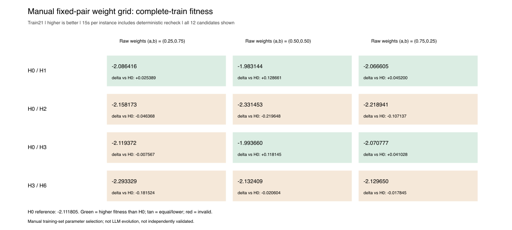
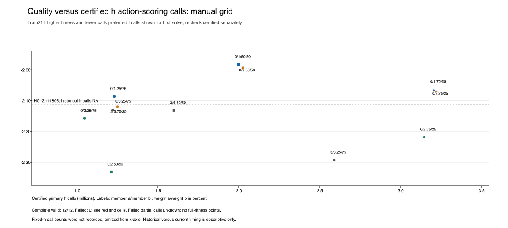

# 全部12候选结果表

全部完整有效；fitness越大越好。胜/负/平相对固定H0；时间为单遍求解/复检之和，各21实例，单位秒。

| 成员对 | 原始权重(a,b) | fitness | Δfitness对H0 | Δ对较好固定组成成员 | 对H0胜/负/平 | 单遍h调用 | 求解/复检s |
|---|---|---:|---:|---:|---:|---:|---:|
| H0/H1 | (0.25,0.75) | -2.086416 | +0.025389 | +0.025389 | 9/12/0 | 1,230,864 | 6.63/6.65 |
| H0/H1 | (0.50,0.50) | -1.983144 | +0.128661 | +0.128661 | 16/3/2 | 1,999,648 | 10.45/10.44 |
| H0/H1 | (0.75,0.25) | -2.066605 | +0.045200 | +0.045200 | 14/4/3 | 3,207,240 | 16.65/16.50 |
| H0/H2 | (0.25,0.75) | -2.158173 | -0.046368 | -0.046368 | 5/15/1 | 1,046,280 | 5.30/5.23 |
| H0/H2 | (0.50,0.50) | -2.331453 | -0.219648 | -0.219648 | 2/19/0 | 1,211,600 | 5.97/5.97 |
| H0/H2 | (0.75,0.25) | -2.218941 | -0.107137 | -0.107137 | 5/14/2 | 3,146,520 | 14.96/14.70 |
| H0/H3 | (0.25,0.75) | -2.119372 | -0.007567 | -0.007567 | 8/13/0 | 1,250,008 | 7.19/7.17 |
| H0/H3 | (0.50,0.50) | -1.993660 | +0.118145 | +0.118145 | 14/7/0 | 2,026,120 | 11.34/11.36 |
| H0/H3 | (0.75,0.25) | -2.070777 | +0.041028 | +0.041028 | 14/4/3 | 3,220,768 | 17.94/17.74 |
| H3/H6 | (0.25,0.75) | -2.293329 | -0.181524 | -0.123040 | 4/16/1 | 2,590,240 | 21.34/21.22 |
| H3/H6 | (0.50,0.50) | -2.132409 | -0.020604 | +0.037880 | 6/15/0 | 1,599,176 | 13.21/13.31 |
| H3/H6 | (0.75,0.25) | -2.129650 | -0.017845 | +0.040639 | 7/12/2 | 1,221,152 | 10.38/10.31 |

H0 fitness为−2.111805；前三对的较好固定组成成员为H0，H3/H6的较好者为H3（−2.170289）。固定h历史调用数未知。完整成绩及全部胜例、退化、相同实例在CSV中保留。

## 最佳候选逐实例成绩

| 实例 | 网格Cmax | H0 | H1 | ΔCmax对H0 | Δscore对H0 |
|---|---:|---:|---:|---:|---:|
| Behnke1.fjsp | 100 | 106 | 113 | -6 | +0.085714 |
| Behnke2.fjsp | 101 | 108 | 122 | -7 | +0.093333 |
| Behnke3.fjsp | 97 | 105 | 122 | -8 | +0.101266 |
| Behnke4.fjsp | 110 | 116 | 121 | -6 | +0.078947 |
| Behnke13.fjsp | 256 | 316 | 296 | -60 | +0.375704 |
| Behnke14.fjsp | 263 | 348 | 292 | -85 | +0.519084 |
| Behnke19.fjsp | 429 | 670 | 532 | -241 | +0.747635 |
| Behnke25.fjsp | 103 | 95 | 103 | +8 | -0.100000 |
| Behnke21.fjsp | 103 | 96 | 103 | +7 | -0.089744 |
| Behnke29.fjsp | 134 | 138 | 133 | -4 | +0.053333 |
| Behnke27.fjsp | 133 | 133 | 154 | +0 | +0.000000 |
| Behnke33.fjsp | 237 | 261 | 248 | -24 | +0.313931 |
| Behnke34.fjsp | 237 | 246 | 255 | -9 | +0.115385 |
| Behnke36.fjsp | 415 | 426 | 420 | -11 | +0.072547 |
| Behnke43.fjsp | 101 | 94 | 101 | +7 | -0.102941 |
| Behnke44.fjsp | 92 | 92 | 95 | +0 | +0.000000 |
| Behnke47.fjsp | 130 | 136 | 140 | -6 | +0.078947 |
| Behnke46.fjsp | 123 | 125 | 137 | -2 | +0.027397 |
| Behnke51.fjsp | 235 | 238 | 240 | -3 | +0.040000 |
| Behnke53.fjsp | 235 | 240 | 235 | -5 | +0.067568 |
| Behnke57.fjsp | 413 | 435 | 424 | -22 | +0.223767 |
