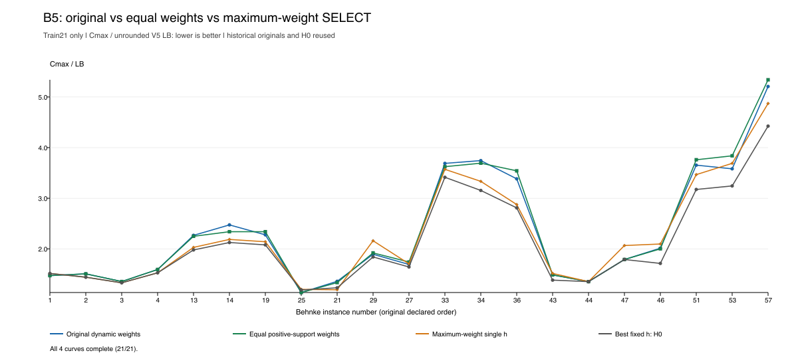
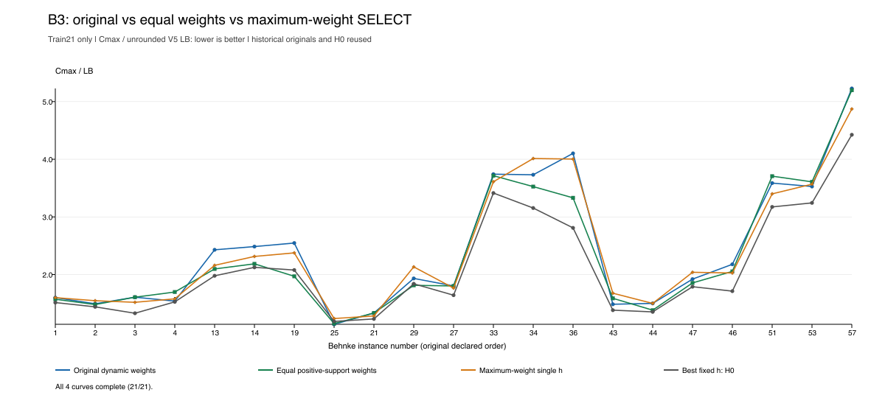
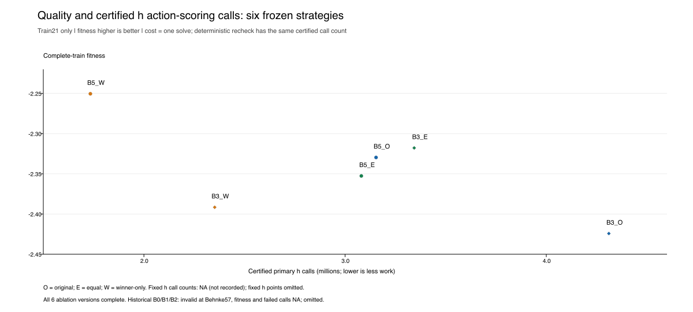

# SELECT/MIX 机制分析与同源消融：seed301 / train21

**四个派生版本均完成原21训练实例及确定性复检；没有新增模型请求、独立诊断回放或holdout评价。两个原组合复用旧评价。** 本轮没有发现原动态组合优于其最大权重单选的平均训练收益；等权相对原权重的结果因候选而异。20个原完整有效U的平均fitness均低于最佳固定H0。局部实例存在收益，不能据此否定整个组合空间。

本目录为新增派生报告，源运行保持为 `runs/v22-gpt61-select-mix-301-20261014-v1/`。`B5`、`B3`分别指原候选 `B/g0000/000005`、`B/g0000/000003`，不是新模型生成的候选。分析使用 [ahd-experiment-copilot 技能](/Users/DDXQL/.codex/skills/ahd-experiment-copilot/SKILL.md) 的指标和证据区分原则；操作授权来自本轮用户明确指令。

## 1. 已有报告与本轮新增内容

[原最终报告](../../docs/H_USAGE_V22_TRAINING_RESULTS.md)已完成生成率、失败/重复、SELECT/MIX行为画像、种群变化、冠军逐实例配对及原调用成本汇总。本轮复用原候选索引、行为画像、逐实例CSV和计时；没有重新整理全部历史，也不改变任何原候选的有效性、种群身份、费用或预算状态。

本轮补充：所有20个完整有效U对全部10条固定h的统一配对、最佳固定H0身份核对、三个超时的成本分解、两个真实组合的四个确定性派生评价、相应图表和机制解释。历史失败记录只提取该批B的三个评价超时；没有把成功前缀重新算成fitness。

## 2. 共同口径及固定H参照

固定H编号0–9为运行时类别编号。**H0实际资产ID是 `H/g0000/000009`**，不是来源ID末尾为000000的规则。其代码键为 `0a9a150a19558cad577ee8a513a9e071a0c9b1efb2b1d6d233cf408089b94f15`。依次校验冻结资产seal、重评资产seal、冻结资产对重评资产的引用、重评对原H的引用，以及10个成员的顺序/代码键；保留原来源与审查，不创建新审查。

只加载原manifest中21个train文件，逐文件哈希匹配原协议。生产实现文件逐个匹配原协议指纹；生产执行器、归一化、状态及原提示均未修改。逐实例重新计算不取整的V5下界：`w_j=Σ每工序最短可选加工时间`，`LB=max(max_j w_j, Σw_j/M)`，`score=−Cmax/LB`；fitness为完整21个score的算术均值，越大越好。固定h、原组合、现有U CSV的LB/score与该口径一致。追加式排程、合法动作及同分规则沿用原实现。

全部10条固定h都完整有效，H0最高（−2.111805），其次H1（−2.119982）、H2（−2.142189）。这是本次train内描述性参照，不是独立数据选出的最优规则。详细固定h成绩/计时见 [汇总表](Ablation_and_fixed_H_summary.csv) 和 [逐实例表](Ablation_and_fixed_H_instances.csv)。

下表的胜/负/平表示U相对H0的makespan更短/更长/相同；实例简称省略Behnke和.fjsp。**全部退化实例及相同实例逐一列在 [H0汇总CSV](All_U_vs_H0_summary.csv)**，并可在 [420行逐实例配对](All_U_vs_H0.csv) 查看数值，不只给胜负数。对全部固定h的 [4200行配对表](All_U_vs_fixed_H.csv) 和 [200行摘要](All_U_vs_fixed_H_summary.csv) 保留所有成员，没有只挑较弱h作对照。

| 原U | fitness | 对H0胜/负/平 | 改善实例 |
|---|---:|---:|---|
| INIT/init/000001 | −2.525153 | 0/19/2 | 无 |
| INIT/init/000003 | −2.608840 | 2/17/2 | 14、19 |
| INIT/init/000005 | −2.225194 | 2/19/0 | 21、57 |
| INIT/init/000006 | −2.391584 | 0/21/0 | 无 |
| INIT/init/000007 | −2.468082 | 2/19/0 | 14、19 |
| A/g0000/000000 | −2.391584 | 0/21/0 | 无 |
| A/g0000/000002 | −2.389651 | 0/21/0 | 无 |
| A/g0000/000003 | −2.557945 | 0/21/0 | 无 |
| A/g0000/000004 | −3.022977 | 0/21/0 | 无 |
| A/g0000/000005 | −2.483434 | 2/18/1 | 1、21 |
| A/g0000/000006 | −2.525153 | 0/19/2 | 无 |
| A/g0000/000007 | −2.185157 | 6/15/0 | 19、21、29、34、47、53 |
| A/g0000/000008 | −2.372608 | 0/21/0 | 无 |
| A/g0000/000009 | −2.532444 | 2/18/1 | 1、21 |
| B/g0000/000003 | −2.424245 | 1/20/0 | 25 |
| B/g0000/000005 | −2.329617 | 2/17/2 | 1、25 |
| B/g0000/000006 | −2.410994 | 2/19/0 | 1、25 |
| B/g0000/000007 | −2.430401 | 2/17/2 | 1、25 |
| B/g0000/000008 | −2.421799 | 1/19/1 | 1 |
| B/g0000/000009 | −2.456138 | 3/17/1 | 1、25、21 |

例如最佳U `A/g0000/000007`虽改善6个实例，其余15个退化，完整fitness仍低于H0约0.073352。不能只报告局部胜例或把固定H4等较弱参照当作“最佳固定h”。

## 3. 实际策略形式与证据边界

原14个完整有效SELECT包括条件产生选择向量、综合/非线性成员评分和常量成员；评分函数可含条件分支。`A/g0000/000000`分数变化但训练赢家始终H4，不能把评分变化直接当成实际自适应。6个完整有效MIX中，B3是实际动态成员对，其余B5/B6/B7/B8/B9为观察到的固定成员对、动态权重；“固定成员对”不等于“固定权重”。完整画像复用并列于 [Existing_valid_U_profiles.json](Existing_valid_U_profiles.json)。

原B5共3800步，始终使用(0,9)，H0归一化权重范围约[0.438943,0.663524]，主导成员为H0的3362步、H9的438步。原B3共3800步，(2,4)出现2145步、(4,7)出现1655步；实例内部共23次成员对切换，主导成员始终H4。这是支持集及权重的真实执行证据，不能替代收益证据。

**旧行为轨迹没有完整合法动作分数列**（观察时`max_actions=0`），仅有分数范围、实际所选动作及权重。因此旧记录不能直接回答“把同一状态的权重换掉，动作会否变化”。本轮没有补做第三遍全量回放。新评价也不记录同状态的动作反事实，具体在哪一步、哪个权重阈值使动作改变仍未知。

本轮多个版本的makespan不同，足以说明完整策略干预后的执行结果不同；这不是单凭权重变化得出的结论。但没有把分歧定位到某一步，也不能给出每个状态的“正确成员”标签。完整fitness仍是整个排程的结果。

## 4. 确定的消融规则及评价次数

全部六个版本源码见 [sources/](sources/)，完整变换规则、原始代码键、派生代码键及源码SHA-256见 [Plan.json](Plan.json)。派生源码均通过当前受限数值语言校验，不用辅助函数、字典或LLM，不进入原种群。

| 版本 | 变换 | 评价来源 |
|---|---|---|
| Original | 保留原状态计算、支持集和动态权重 | 各复用一次原21实例完整评价 |
| Equal | 在原U每个终端return处按原顺序计算权重表达式一次；每个正项换成1，其余换成0；仍MIX，由原host归一化为等权 | 各新增一次完整train评价，含复检 |
| Winner | 原计算和向量不变，只将终端MIX=1换成SELECT=0；原非负权重的argmax等同归一化后argmax；同分最小编号 | 各新增一次完整train评价，含复检；每步仅评分一个h |

两原U的每个返回均为MIX，变换器拒绝不符合该前提的源码。等权版本会在(2,4)时由H2主导，在(4,7)时由H4主导；Winner用原始h动作分数，双成员仍按全部当前合法动作逐h min–max后加权。**没有让单选调用两条h，也没有修改生产执行器。**

`previous_heuristic`仍由执行器根据该版本本步最大实际权重成员更新，同权取小编号。等权会改变历史成员；动作变化还会改变后续状态与成员对。两个冻结U虽然不读取`previous_heuristic`参数，排程状态的反馈仍然存在。因此这些是完整策略干预，不能声称只隔离了某个权重系数。B3等权轨迹实际变为(2,4)1474步、(4,7)2326步，并不应强行固定成原轨迹的2145/1655。

每个新版本只调用一次既有主评价，含首次排程及确定性复检，两遍合计沿用每实例15秒期限。没有额外独立诊断回放。若有失败，整体fitness应为null并保留成功前缀；本轮四个新版本均完整有效。独占启动标记拒绝整批重复调用；没有自动加时、补发或重跑。

## 5. 完整结果、收益与代价

下表h调用数是**单遍**合法动作评分次数；确定性复检次数逐项一致。时间为21实例首次排程与复检各自之和，单位秒。所有表中6个版本及相关固定h均完整有效。

| 版本 | fitness ↑ | 单遍h调用 | 首次求解s | 复检s |
|---|---:|---:|---:|---:|
| B5 Original | −2.329617 | 3,153,792 | 21.68 | 21.68 |
| B5 Equal | −2.352611 | 3,080,640 | 22.42 | 22.56 |
| B5 Winner | −2.250396 | 1,733,916 | 11.72 | 11.57 |
| B3 Original | −2.424245 | 4,310,832 | 23.69 | 23.56 |
| B3 Equal | −2.317779 | 3,343,416 | 22.92 | 22.63 |
| B3 Winner | −2.391584 | 2,351,784 | 14.41 | 14.65 |
| 固定H0 | −2.111805 | NA | 14.10 | 13.14 |
| 固定H2 | −2.142189 | NA | 1.29 | 1.54 |
| 固定H4 | −2.391584 | NA | 13.67 | 14.74 |
| 固定H7 | −2.477265 | NA | 10.89 | 10.92 |
| 固定H9 | −2.561150 | NA | 12.17 | 11.82 |

固定h原评价未记录h调用数，NA保留未知，不能填0。也不能把本轮B3 Winner的次数回填成历史H4的“实测次数”。B3 Winner在这21实例上确实每步选H4，makespan向量与固定H4一致。

[逐实例完整表](Ablation_and_fixed_H_instances.csv)共336行（六版本＋十固定h，各21行），包含Cmax、LB、score、对H0胜负、求解/复检时间和可认证调用数；[汇总表](Ablation_and_fixed_H_summary.csv)含有效性、完整fitness及成本范围。缺失值为空而非0。

| 干预版本相对原组合 | 干预胜/负/平 | fitness变化（干预−原） |
|---|---:|---:|
| B5 Equal | 6/7/8 | −0.022994 |
| B5 Winner | 12/8/1 | +0.079221 |
| B3 Equal | 13/5/3 | +0.106466 |
| B3 Winner | 11/8/2 | +0.032661 |

**动态权重：** B5原权重平均优于等权0.022994，但只在7个实例胜等权、6个实例负、8个相同；B3原权重则明显低于等权0.106466。动态权重并未表现出一致优势。例如B5在Behnke57为原512、等权525，原权重有利；Behnke14为原405、等权383，方向相反。B3在Behnke19为原821、等权635，在Behnke36为622对505；这两例体现了原动态权重的代价。B3在Behnke25为原91、等权92，则保留小幅局部收益。

**第二个成员：** B5 Winner的完整fitness更高，单遍调用从315万降到173万；B3 Winner也优于原组合，调用从431万降到235万。原组合分别只在8个实例胜对应Winner。因此没有观察到两个原组合的平均双成员收益。不过B3 Equal优于B3 Winner（12胜9负、平均高0.073805）：在相同动态成员对选择公式的完整策略干预下，等权加入另一成员有训练收益。B5 Equal则低于其Winner（6胜14负1平）。不能用“原权重失败”断言第二成员总无用，也不能用“B3等权有利”推广全部组合。

局部例子：B5原组合在Behnke29/47分别为142/136，而Winner为162/157；但Behnke19/36原组合为734/513，Winner为690/436。B3 Equal在Behnke19/34/36为635/275/505，Winner为766/313/607；Behnke51则为278对255，存在代价。相关固定H0依然是本轮全部版本中平均fitness最高的参照，六个版本无一超过它。

四次新增主评价墙钟合计约144.17秒，包含进程及收集开销，不能再与其内部求解/复检时间相加。新增主排程认证h调用共10,509,756次，复检同数；没有新增模型token或费用。资源快照保存在启动记录中：评价在本页串行，快照包含本页进程，没有识别到另一页密集求解的证据；操作系统资源没有独占，因此也没有严格排除资源竞争的证明。原组合和固定h使用历史计时，不能作精确速度倍数/优劣结论。质量—成本主图因此采用可认证h调用数；调用数也不是CPU指令成本，不同h单次调用可有不同开销。

### 图表







图中逐实例纵轴为`Cmax/LB`（越小越好），质量—成本图纵轴为fitness（越大越好）。保留原声明实例顺序，H0单列参照。可编辑矢量版位于 [figures/](figures/)。六版本无失败；历史B0/B1/B2无完整fitness和失败调用数，在成本图脚注明确标为NA并不画伪完整点。固定h调用未知，也不放在x=0冒充零成本。

## 6. 三个历史超时：证据和解释

三个候选都在第21个实例Behnke57失败，完整fitness为null。下表只统计**前20个成功实例**的内部耗时与h调用；主评价墙钟另含最后实例的约15秒超时及启动/收集开销。

| 候选 | 主评价墙钟s | 前缀首次/复检s | 前缀单遍h调用 | 前缀h评分s | 前缀组合处理s |
|---|---:|---:|---:|---:|---:|
| B0 | 64.37 | 25.08 / 23.69 | 2,939,232 | 21.96 | 1.59 |
| B1 | 62.74 | 23.61 / 23.60 | 3,182,000 | 21.09 | 1.31 |
| B2 | 52.07 | 18.26 / 18.33 | 3,144,448 | 15.89 | 1.26 |

完整机器表为 [Historical_timeout_costs.csv](Historical_timeout_costs.csv)，含既有成功前缀独立诊断墙钟（约25.27/26.60/19.53秒）。这些是旧批次成本，本轮未再诊断这三个失败候选。

**可直接支持的解释：** 三者的成功前缀均真实双成员执行，h评分占首次求解约87.6%、89.3%、87.0%，组合归一化/加权处理约6.3%、5.6%、6.9%；主成本已集中在大量合法动作的两条h评分，而不只是U的条件分支。B0固定(4,9)；B1/B2在(2,4)/(4,7)变化。B1前缀约154.1万次调用落在H7，只有5万次落在H2；B2两者约76.3万/80.9万。源码中H7包含多项clamp、除法与组合计算；h每动作调用，编译器还做既定数值边界检查，成本会累计。不同排程使后续候选动作数不同，成员对及调度路径都可能影响总成本。

同一个Behnke57，完整有效B5单遍调用689,576次，求解/复检约4.67/4.69秒；B3单遍调用1,223,464次，约6.83/6.88秒，两遍已接近原15秒期限。该实例为500工序，比成功前缀中的单实例更重，说明固定“两遍共享15秒”对轨迹及调用成本敏感；不能把每遍单独看成15秒。

**仍属推测/未知：** 三个失败实例没有认证的部分调用数，也没有分离的首次/复检完成时间，不能知道具体卡在哪一遍、最终会得到什么Cmax，或把前缀按比例外推为实测成本。H7公式较重、成员选择导致动作枚举增加、当时机器负载等是可能来源，现有数据不能分别定量归因；不能声称“if多导致超时”或“组合处理就是主瓶颈”。本轮没有直接加长时限，也没有修候选或重跑失败实例。

## 7. 下一轮只验证一个问题（本轮未执行）

**同一状态下，原权重相对等权究竟在多少步改变了动作，这些分歧对应哪些排序冲突？** 先保留这两个冻结原U，预先只选已见训练实例Behnke19、Behnke57，每个U×实例各一次带既定复检的诊断评价，共4个候选—实例对，不做LLM搜索、不扩数据、不追选冠军。另行登记该小诊断后，在原排程一次已有的两条h动作分数列上计算等权及winner的影子argmax，沿用相同合法动作和同分规则；影子选择不更新调度及previous_heuristic，也不新增h调用。

逐步保存原选动作、等权/单选影子动作、冲突计数和少量完整动作列实例，可定位第一次分歧及冲突结构。这能补“同状态动作敏感性”证据，仍不能仅凭局部影子胜负推断完整排程收益；本轮完整策略消融与未来同状态诊断需配合解释。新增实例、时限、种子或搜索均不包含在此建议内。

本轮只有两个从原训练结果选出的真实组合，存在选择偏差；原始候选、等权和Winner的后续状态不同，没有独立数据或多seed重复。结果既不能建立动态组合的普遍优势，也不能证明它普遍无效；候选有效、进入种群、切换更多或权重变化都不作为收益指标。

## 8. 可复核文件与验证

- [Plan.json](Plan.json)：六版本、变换规则、来源和数据/实现哈希；[Evaluation_complete.json](Evaluation_complete.json)：仅21train实际打开记录、四次新增评价及原证据哈希复核。
- [results/](results/)：六个版本完整结果，含每步模式/支持集/归一化权重/主导成员的紧凑记录；原始版本直接指向原checkpoint身份，不复制旧全部状态轨迹。[Ablation_behavior.json](Ablation_behavior.json)汇总实际行为。
- [Analysis_checks.json](Analysis_checks.json)：20个有效U、10个固定h、统一口径及H0身份；全部原始引用文件哈希保持一致。
- 新入口 [usage_mechanism_ablation.py](../../tools/usage_mechanism_ablation.py) 仅作确定性派生与一次评价；[report_usage_ablation.py](../../tools/report_usage_ablation.py) 只读结果制表；[plot_usage_ablation.py](../../tools/plot_usage_ablation.py) 使用现有ReportLab绘图，不安装网络依赖。
- 局部检查4项通过：真实两源码在两分支状态下的支持集/argmax、同分及零项、主导历史输入、winner只调用选中h、变量碰撞与错误原模式拒绝。未重跑全套测试。
- 原模型提示、运行配置、生产执行器和冻结资产均未改动；新增目录不含密钥、原始账单或新请求。表图复核后与诊断代码一同正常提交推送。

复核命令（在本worktree，已完成；不要重复评价）：

```bash
PYTHONDONTWRITEBYTECODE=1 PYTHONPATH=code:tests:. .venv/bin/python -B -m unittest test_usage_mechanism_ablation -v
# 以下只读已保存结果并更新本派生目录，不会重新评价：
PYTHONDONTWRITEBYTECODE=1 .venv/bin/python -B tools/report_usage_ablation.py
```

评价入口的`prepare`要求新目录；`evaluate`要求独占启动标记未存在。本轮标记已存在，重复启动会拒绝，不应用删除标记的方式重评。
