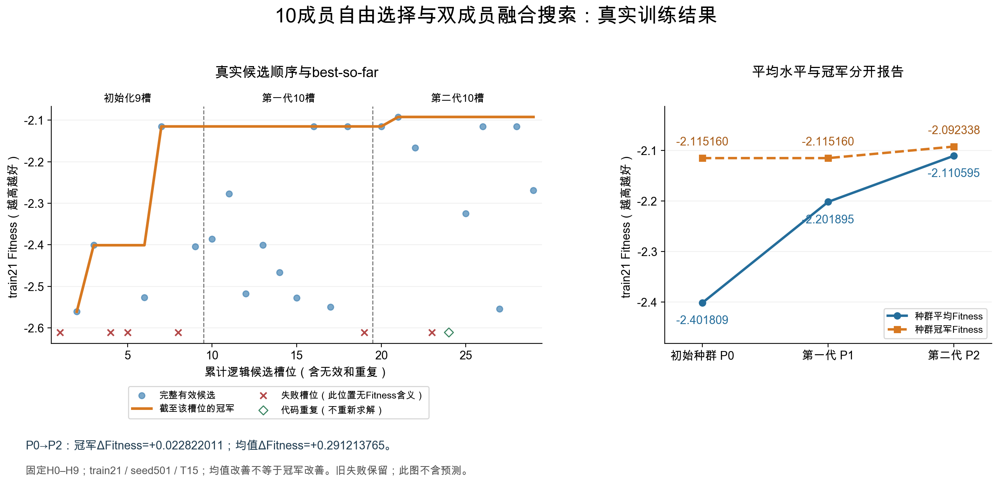

# 近期实验总览与重要图表索引

本文面向首次了解项目的读者：先解释研究对象，再按研究问题介绍实验。**描述性中文名称是正文名称；B1、B2、V2等只保留为查找历史文件的内部代号。** 它们不是统一的算法分类，也不表示后一项覆盖、替代了前一项。

## 先了解我们在研究什么

- **FJSP（柔性作业车间调度）**：为每道工序决定在哪台可选机器上加工，并安排加工顺序；希望所有作业尽早完成。
- **H：底层启发式。** H0–H9是已经冻结的10份规则代码。给定当前合法的“工序—机器”动作，每个H为动作打分。编号在历史审阅／冻结阶段按train21单成员成绩排序，不应理解为随机编号。
- **U：利用程序。** U读取七维排程状态，决定用哪个H，或怎样组合H。七维输入为工序分配进度、候选动作比例、剩余工作量均值／标准差、机器就绪时间均值／标准差、上次主导H编号；不是直接读取未来收益。
- **SELECT（单成员选择）**：U给各H成员选择分数，执行器选出一个H，再用该H给动作打分。**MIX／WEIGHTED_SUM／WS（加权融合）**：U指定最多两个正权重成员；双成员时，每个H对当前合法动作的评分分别归一化，再加权选择动作。成员选择分数与H的动作分数是两层不同的分数。
- **静态与动态**：静态策略在整次排程中固定成员和权重；动态策略允许随状态改变它们。代码出现if/else不等于已经证明动态收益，实际行为和完整排程成绩要分别核查。
- **评价指标**：单实例得分为−Cmax/LB；Cmax是最终完工时间，LB是按项目规则计算的下界。Fitness是声明实例集上得分的算术均值，**越大、越接近0越好**。不是总Cmax，也不是各实例百分比改善的均值。
- **数据与认证**：train21是用于开发、搜索和选择的21个训练实例；求解seed通常为501，另有明确标注的历史201／301实验。首解／复检是同一策略的两遍一致性检查，不算两份独立科研样本。任一实例未完成时，完整Fitness记为null，不使用成功前缀均值。
- **预算与种群**：逻辑槽位是一次预定生成机会，API尝试是实际模型请求；完整响应不等于合法代码，更不等于完整认证。P0为初始种群，P1为第一代选择后的种群，P2为第二代选择后的种群。partial表示只完成原计划的一部分。
- **T15／T30**：评价器等待结果的期限配置，分别为15／30秒；不是整个实验的总时长，也不能简单当作纯求解本体耗时。不同版本还有收集与退出留证差异，比较时保留来源。

下文沿用既有盘点与认证来源，不新增实验。同一实验的缓存、复检、恢复和报告副本不重复计数。“冠军”只指指定实验／数据范围内最好；“较新的冠军”指后来实验发现的另一份程序，不会覆盖历史冠军或原始记录。

## 怎样直接看图

JSON/CSV是原始数据或账本，不是图片；无法在当前界面打开它们，不代表没有图。**先点总表“看图（PNG）”列，或直接看下方图片预览。** VS Code中可按`Command+Shift+V`打开本文Markdown预览；Windows/Linux为`Ctrl+Shift+V`。原始证据列保留，供需要时核对，不要求先读大JSON。

|类别|实验|主要设置/目的|实际状态|主要结果|边界|看图（PNG）|原始证据（可选）|
|---|---|---|---|---|---|---|---|
|固定H/静态融合|单规则与等权组合全扫描＋固定H0/H1权重曲线（详见1–4、8）|10单H，45等权对综合，H01静态21点|已完成质量覆盖|最好单H为H0：−2.111805；最好等权对H0/H1：−1.983144；单H事后选择：−2.032977|混合T15/T30/历史缓存；不是全权重最优|[单H](<../组会实验盘点-20261027-v1/图表/01_单H排名.png>) / [45对](<../组会实验盘点-20261027-v1/图表/02_等权45对分布.png>) / [权重曲线](<../组会实验盘点-20261027-v1/图表/03_H01静态权重曲线.png>)|[Summary.json](</Users/DDXQL/Documents/大学/硕士/代码/FJSP-Heuristic-Research-h-usage-space/reports/tier2-baseline-a-train21-seed501-20261024-v1/Summary.json>)|
|初始化/覆盖|单选／融合生成检查＋10成员自由搜索覆盖检查（详见6–7）|固定请求槽位，合法/重复/状态诊断|原P1阶段覆盖快照；P2见下一行|10成员自由搜索14/19完整有效，实际使用7种成员对，未观察到H0/H1双成员步|未做纯初始化多样性消融|[有效率与组合覆盖](<图表/初始化与实际组合覆盖.png>)|[Summary.json](</Users/DDXQL/Documents/大学/硕士/代码/FJSP-Heuristic-Research-h-usage-space/reports/b1-ns-recovery-B-execution-20261023/Summary.json>)|
|生成/演化|10成员自由选择与双成员融合的两代搜索（B1，2026-10-27接续完成）|自由初始化；N5；每代5次交叉＋5次变异；train21/501|两代已完成；累计29槽／29次API；本轮第二代8认证＋1重复＋1隔离|冠军−2.115160→−2.092338；平均Cmax/LB降低1.079%；11胜6负4平|仍弱于H0/H1等权；保留原超时与退出隔离，清理器分阶段披露|[两代真实搜索与种群](<../b1-p1-to-p2-T15-seed501-20261027-v1/图表/10H自由搜索_真实搜索与种群.png>)|[补跑中文报告](<../b1-p1-to-p2-T15-seed501-20261027-v1/REPORT_ZH.md>)|
|生成/演化|固定H0/H1的两代动态权重演化（内部B2，详见8）|共同5静态P0，2代20演化槽|完成|两代动态权重冠军−1.982226；相对等权Fitness提高0.000918|另有网格/P0投入；训练内单重复|[搜索与种群](<../组会实验盘点-20261027-v1/图表/04_B1_B2搜索与种群.png>)|[checkpoint.json](</Users/DDXQL/Documents/大学/硕士/代码/FJSP-Heuristic-Research-h-usage-space/runs/h01-state-weight-search-seed501-batch-v3-20261020/r501/B/checkpoint.json>)|
|独立生成／演化对照|每次独立生成U与利用父代演化U的对照（详见9）|固定H0/H1，共同5个初始策略，各20个新增槽|113/120，只有重复1双方完整|演化组较新冠军−1.975489；两个搜索重复出现超过共同初始冠军的子代|故障/partial不平衡，不能断言稳定胜出|[三重复搜索曲线](<../组会实验盘点-20261027-v1/图表/09_IND_EVO探索性比较.png>)|[Completion.csv](</Users/DDXQL/Documents/大学/硕士/代码/FJSP-Heuristic-Research-h-usage-space/reports/ind-vs-evo-h01-train21-seed501-20261026-v1/closeout-v1/Completion.csv>)|
|融合/状态消融|最大值／最小值／秩融合及进度切换规则（详见14–17）|固定算子/预定阈值，0模型搜索|V2/V3有失败隔离，V4/规则族完整|观察到动作差异；已测MAX/MIN/Borda及简单切换未超过静态等权|局部表达≠收益；未开放正式LLM算子搜索|[机制与质量](<../组会实验盘点-20261027-v1/图表/07_融合表达与质量.png>) / [固定规则族](<../组会实验盘点-20261027-v1/图表/11_预定动态规则族.png>)|[Ranking.csv](</Users/DDXQL/Documents/大学/硕士/代码/FJSP-Heuristic-Research-h-usage-space/reports/fusion-v2-train21-seed501-20261023-v2/Ranking.csv>)|
|反馈/传统基线|交叉时提供父代成绩＋成员与静态权重随机搜索（详见18–20）|A/B只差父代成绩；865个规范静态策略中随机搜索|A/B30槽；A4 93/300|提供父代成绩未见改善迹象；静态随机搜索首轮冠军−2.022083|5父代任务；非同预算因果对照|[反馈A/B](<../组会实验盘点-20261027-v1/图表/12_CROSS成绩反馈分任务.png>) / [A4](<../组会实验盘点-20261027-v1/图表/08_A4完整与部分路径.png>)|[Candidates.csv](</Users/DDXQL/Documents/大学/硕士/代码/FJSP-Heuristic-Research-h-usage-space/reports/cross-feedback-ab-train21-seed501-v1-20261025/execution-v2/Candidates.csv>)|
|独立/跨族验证|较早动态冠军的28实例验证＋较新动态冠军的Hurink20实例验证（详见21–22）|不同冻结冠军、不同分布分开评价|两批各自完成|旧12胜14负2平；新2胜18负|已暴露；Hurink不是原Mk计划|[Hurink验证](<../组会实验盘点-20261027-v1/图表/10_冻结冠军训练外验证.png>)|[Paired_instance_results.csv](</Users/DDXQL/Documents/大学/硕士/代码/FJSP-Heuristic-Research-h-usage-space/reports/h01-champion-hurink-rdata20-seed501-20261026-v1/Paired_instance_results.csv>)|
|TSP迁移|构造型TSP的H/U双层框架迁移试点（详见23）|合成欧氏50城市，独立工作树|接口／模拟验收／人工H求解，10份真实H响应；尚未生成U|尚无真实U生成/演化成绩|不是四个TSPLIB实例，也非旧EvoFlow|[迁移进度（不是质量成绩）](<图表/TSP迁移证据进度.png>)|[Campaign_state.json](</Users/DDXQL/Documents/大学/硕士/代码/FJSP-Heuristic-Research-tsp-pilot/runs/tsp-pilot-20261026-v1/Campaign_state.json>)|

详细逐项：[重要实验详细附表.csv](</Users/DDXQL/Documents/大学/硕士/代码/FJSP-Heuristic-Research-h-usage-space/reports/师兄讨论材料-20261027-v1/重要实验详细附表.csv>)；历史总目录：[实验资产总目录.md](</Users/DDXQL/Documents/大学/硕士/代码/FJSP-Heuristic-Research-h-usage-space/reports/组会实验盘点-20261027-v1/实验资产总目录.md>)。

## 逐项解释：每个实验到底做了什么

以下23项对应原盘点[重要实验详细附表.csv](重要实验详细附表.csv)；第7项已补充2026-10-27的第二代接续结果，原CSV快照保留。设置、结果、完成量来自既有证据索引；本次增加通俗解释和名称映射，不改变旧成绩。各项有不同空间、先验、预算与执行器，不能把跨项质量排名当作搜索效率的公平对照。

### 1. 生成、审阅并冻结10个底层动作评分规则（Tier 1）

- **要回答的问题**：先得到后续所有U共同使用的“工具箱”，而不是每次比较U时重新生成H。H负责评价动作，U负责利用H，两阶段的搜索不是同一件事。
- **具体怎么做／与其他项的区别**：历史流程包含导入已有候选和新生成／演化，最后审阅并按训练单H成绩编号。H搜索seed为7，与U求解seed501不同。H0最好是编号排序事实，不是10个随机编号恰好严格递减。
- **设置与完成情况**：单动作评分H；本项目最小EoH-S适配；train21；H搜索7（非501）。正式完整；v1 9尝试、v2 3尝试；v3导入8H后22新尝试（2初始化+20演化）；不能重复加总导入成员。
- **实际结果**：冻结10H；最好H0=-2.111804960626；按train21单H均值排序编号。
- **证据边界**：本卡仅H阶段完整；同目录后续U阶段中断。历史完整源码闭包未全部恢复，非相邻EoH-S全runner复现。
- **历史检索名与证据**：`Tier 1实际H生成、导入、审阅与冻结`；[原始成绩／账本／索引](</Users/DDXQL/Documents/大学/硕士/代码/FJSP-Heuristic-Research-h-usage-space/reports/baseline-a-provenance-timeout-audit-20261024-v1/H_mapping.csv>)。

### 2. 人工指定4种成员对、每对3种静态权重的初步扫描

- **要回答的问题**：在进行大范围搜索前，先看两规则组合有没有潜力。
- **具体怎么做／与其他项的区别**：人工固定成员与权重后完整求解，共12个策略；没有让LLM选择组合。它发现H0/H1等权很强，但不能据此断言它是全部成员对或连续权重的最优。
- **设置与完成情况**：4成员对，每对3个固定比例；train21；501参照；原配置为准。正式完整；12完整策略；API0。
- **实际结果**：最好H0/H1等权=-1.983144294915。
- **证据边界**：不是45对扫描，不是H01的21点网格；后续复用不算新增评价。
- **历史检索名与证据**：`早期4对×3权重静态扫描`；[原始成绩／账本／索引](</Users/DDXQL/Documents/大学/硕士/代码/FJSP-Heuristic-Research-h-usage-space/reports/usage-fixed-pair-weight-grid-20261018-v1/Grid_summary.csv>)。

### 3. 10个单规则、45个等权成员对及单规则事后选择参照（Baseline-A原批）

- **要回答的问题**：建立可重复使用的静态参照，避免只拿LLM程序与一个较弱单H比较。
- **具体怎么做／与其他项的区别**：A1分别评价10个单H；A2枚举45个无序成员对并固定等权；A3对每个实例事后挑单H中最好者再汇总。A3即Single-H Oracle：不是能在线预知赢家的算法，也不是动态策略的理论上界。
- **设置与完成情况**：10单H＋45固定WS；事后Oracle；train21；501。正式完整；10单H有效；45对任务全终结39有效6null；41新策略、14缓存；847首解+847复检启动。
- **实际结果**：Best Single=-2.111804960626；Best Pair=-1.983144294915。
- **证据边界**：正式完整指任务终结，不指55策略全有效；旧6null保留；legacy缓存不是T15同期结果。
- **历史检索名与证据**：`Baseline-A原批`；[原始成绩／账本／索引](</Users/DDXQL/Documents/大学/硕士/代码/FJSP-Heuristic-Research-h-usage-space/reports/tier2-baseline-a-train21-seed501-20261024-v1/Summary.json>)。

### 4. 用独立30秒协议补测6个超时成员对，并核对3个参照

- **要回答的问题**：原扫描6对完整Fitness为null，不能将其排除后声称覆盖全部45对。
- **具体怎么做／与其他项的区别**：固定补测6对，加H0、H0/H1等权、H0/H3等权作同期核查，共9个策略。综合45对排行榜使用39份旧结果与6份新结果；旧15秒失败记录保留，不改成成功。
- **设置与完成情况**：6原超时对＋H0/H01/H03；train21；501。正式完整；9/9有效，189项/378遍；全部新评，缓存抵扣0；0API。
- **实际结果**：综合45对全部有效；H01仍第1，无新对超过B2。
- **证据边界**：综合表39旧+6新，不是45对同期T30；改变期限同时改变收集机制，不能只归因秒数。
- **历史检索名与证据**：`Baseline-A独立T30补测`；[原始成绩／账本／索引](</Users/DDXQL/Documents/大学/硕士/代码/FJSP-Heuristic-Research-h-usage-space/reports/baseline-a-supplemental-T30-seed501-20261024-v1/Composite_pairs_45.csv>)。

### 5. 早期“只选一个H”的四流程训练试验（旧单成员四组）

- **要回答的问题**：在只允许单成员选择的旧接口下，比较不同生成／搜索流程。
- **具体怎么做／与其他项的区别**：这是seed201的早期实验，组名也曾用B0/B1/B2/P；这些名称与后来的“10成员自由搜索B1”“H0/H1权重演化B2”不是同一实验。基础设施故障造成实际生成机会不一致，最终冠军来自共同初始化。
- **设置与完成情况**：旧SELECT；四组旧名B0/B1/B2/P，不等于后来的自由B1/H01-B2；train21；201。正式完整；47正式槽位，32实际正式生成；另1诊断请求。旧模型503阶段单独保留。
- **实际结果**：四组最终冠军均−2.070427513558，来自共同初始化；新有效共21（含5初始化）。
- **证据边界**：槽位完成但B1实际发送0；四组算法比较被基础设施故障破坏；不能当公平方法证据。
- **历史检索名与证据**：`旧单成员四组gpt-6.1训练`；[原始成绩／账本／索引](</Users/DDXQL/Documents/大学/硕士/代码/FJSP-Heuristic-Research-h-usage-space/runs/single-ID-gpt61-paired-training-20261014-v1/Reconciled_training_results.json>)。

### 6. 允许单成员选择或双成员融合的两组生成试验（提示版本v2.2）

- **要回答的问题**：检查开放双成员融合后，LLM能否生成合法程序，以及是否带来排程改善。
- **具体怎么做／与其他项的区别**：两组共用初始化；一组限制单成员选择，另一组开放选择／融合。使用seed301，记录源码合法性、实际输出和完整训练成绩。两组冠军没有超过固定H0；不能把它与“提供父代成绩”的另一个A/B混淆。
- **设置与完成情况**：10H SELECT/MIX；共享P0，A/B；train21；301。正式完整；28槽/28发送：INIT8+两组各10；20完整有效（含5初始化），0源码重复。
- **实际结果**：A冠军−2.185156683819，B冠军−2.225194303278；未超过固定H0。
- **证据边界**：单seed；初始化和父代机制与后来的B1/B2不同；不混称新版A/B成绩反馈。
- **历史检索名与证据**：`v2.2 SELECT/MIX双组真实试验`；[原始成绩／账本／索引](</Users/DDXQL/Documents/大学/硕士/代码/FJSP-Heuristic-Research-h-usage-space/docs/usage-space/real-gpt61-301/Complete_summary.json>)。

### 7. 在全部10个H中自由选择成员与融合方式的演化搜索（内部B1）

- **要回答的问题**：不事先指定H0/H1，让LLM自己发现成员、状态条件与最多双成员的融合方式。
- **具体怎么做／与其他项的区别**：初始种群由LLM生成，交叉用两个父代。非流式是API传输方式，Recovery-B是同一搜索的隔离恢复链，不是新的算法或独立重复。原计划两代，但第一代最后候选在Behnke57等待超时、缺少结束身份留证；代末P1已保存，准备第二代时安全门禁停止。并非预算耗尽或成绩差触发早停，第二代请求为0。
- **设置与完成情况**：10H SELECT/MIX；k=2交叉；train21；501。正式部分完成；19槽/19发送/14完整有效；9初始化+10演化；其中6请求继承、13本恢复新请求；15评价含3次重认证。
- **实际结果**：P0/P1冠军均-2.115159624700，P1均值改善；未访问H0/H1双成员执行。
- **证据边界**：P2未完成；最后超时无after留证，身份停止不能追认原前缀；旧与恢复不算独立重复。
- **历史检索名与证据**：`B1非流式与Recovery-B`；[原始成绩／账本／索引](</Users/DDXQL/Documents/大学/硕士/代码/FJSP-Heuristic-Research-h-usage-space/reports/b1-ns-recovery-B-execution-20261023/Summary.json>)。

停止原因的原始链条见[执行日志](../../runs/b1-ns-recovery-B-v1-20261022/Continuation_execution.log)、[终止回执](../../runs/b1-ns-recovery-B-v1-20261022/Execution_terminal.json)及[后续超时边界审计](../b1-ns-timeout-boundary-review-20261023/REPORT_ZH.md)。旧记录没有完整保存最终退出码，不能把“未见after”解释成“源码已变化”，也不能追认失败候选的20实例前缀为完整成绩。

**2026-10-27接续更新：原计划第二代现已完成。** 上面的19槽、P1停止和7对覆盖属于原批次历史快照，不改写旧记录。此次从P1接续原10槽，累计29槽／29次API，形成P2；第二代8个完整认证、1个代码重复、1个正常退出异常隔离。冠军改善到−2.092337613385（较P1平均Cmax/LB降低1.079%，21实例11胜6负4平），种群均值为−2.110595222437。期间更换的是收齐结果后的退出清理宽限，T15结果等待、评分和提示不变，未重跑失败候选。仍未超过静态H0/H1等权，不能将此改善解释为动态策略或搜索方法普遍更优。

[本次完整报告](../b1-p1-to-p2-T15-seed501-20261027-v1/REPORT_ZH.md)／[全部29槽](../b1-p1-to-p2-T15-seed501-20261027-v1/Candidates.csv)／[冠军逐实例对照](../b1-p1-to-p2-T15-seed501-20261027-v1/冠军逐实例对照.csv)。

### 8. 固定H0/H1的21点静态权重扫描与两代动态权重演化（内部B2）

- **要回答的问题**：把“选哪些成员”固定，只研究“随状态改变权重是否比固定权重好”。
- **具体怎么做／与其他项的区别**：先有5个手工静态初始策略，H0权重为0、0.25、0.5、0.75、1；静态网格测试21个比例。随后从静态初始种群开展两代交叉／变异，生成允许状态相关权重的U。动态冠军−1.982226488242比等权−1.983144294915略好；这是较早的一次受限空间搜索，不是整个10H搜索，也不含后来新冠军。
- **设置与完成情况**：固定H0/H1，静态网格与动态U；train21；501。正式完整；5手工P0；21网格=16新+5复用；20演化请求/20响应/19新有效+1重复；新增35完整评价=735项/1470遍。
- **实际结果**：静态最佳α=.5；动态=-1.982226488242，ΔF=+0.000917806673。
- **证据边界**：原T15/legacy两遍记录，非现代完整退出回执；20不等于从零总成本，副本目录“ 2”不是新重复。
- **历史检索名与证据**：`H01静态21点网格＋历史B2两代演化`；[原始成绩／账本／索引](</Users/DDXQL/Documents/大学/硕士/代码/FJSP-Heuristic-Research-h-usage-space/runs/h01-state-weight-search-seed501-batch-v3-20261020/r501/B/checkpoint.json>)。

### 9. 相同新增候选预算下：每次独立生成U，对比利用父代演化U（IND vs EVO）

- **要回答的问题**：检验整个演化流程是否比反复独立生成更容易发现好U。
- **具体怎么做／与其他项的区别**：IND是independent generation：每次使用独立上下文，不看父代或历史；EVO是evolution：利用父代、交叉、变异和群体更新。双方固定H0/H1、共用5个静态P0，每个重复各20个新增槽，计划3重复。比较包含父代信息利用的整体流程，不能拆成单独交叉或选择的贡献。r2_EVO_s16表示第2重复演化组第16个逻辑候选；“较新冠军”仅指该实验后发现的训练冠军。
- **设置与完成情况**：H01动态/静态U，共同5静态P0；train21；3新搜索重复；求解501。正式部分完成；113/120逻辑，117API尝试；108响应107完整质量认证；仅重复1双方20/20。
- **实际结果**：EVO两重复突破；最佳r2_EVO_s16 −1.975488675215；IND无突破。
- **证据边界**：断电/续跑、8次503和1次524；7未启动，单次评价失败；不能强推稳定方法优越。
- **历史检索名与证据**：`独立生成IND vs完整演化EVO`；[原始成绩／账本／索引](</Users/DDXQL/Documents/大学/硕士/代码/FJSP-Heuristic-Research-h-usage-space/reports/ind-vs-evo-h01-train21-seed501-20261026-v1/closeout-v1/Completion.csv>)。

### 10. 对已生成U进行机制拆分，并与固定规则比较

- **要回答的问题**：排查成绩来自真正的融合／状态利用，还是只由某个固定H主导。
- **具体怎么做／与其他项的区别**：对现有U构造equal、dominant等受控变体，使用预定清单比较。人工诊断变体不是LLM新发现的候选，也不构成一轮新的独立搜索。
- **设置与完成情况**：已有U及equal/dominant等受控变体；train21；301。探索性诊断；固定清单见Ablation_and_fixed_H_summary.csv；API0。
- **实际结果**：保留所有变体完整/失败，不能把人工变体记成LLM新发现。
- **证据边界**：属训练内诊断，不是新独立搜索重复。
- **历史检索名与证据**：`v2.2机制消融与固定H参照`；[原始成绩／账本／索引](</Users/DDXQL/Documents/大学/硕士/代码/FJSP-Heuristic-Research-h-usage-space/reports/usage-v22-mechanism-ablation-301-20261017-v1/Ablation_and_fixed_H_summary.csv>)。

### 11. 在相同排程状态下比较10个H的首选动作

- **要回答的问题**：先确认冻结工具箱中的H是否真的给出不同决策，避免只因代码不同就认定互补。
- **具体怎么做／与其他项的区别**：利用保存轨迹，在相同物理状态对10个H评分并比较首选动作；384条记录对应364个不同物理状态。动作差异是决策多样性证据，不是完整排程收益证据。
- **设置与完成情况**：10H保存状态的影子评分；train21已有轨迹；501参照。探索性诊断；384状态、364不同物理状态；0新增完整Fitness/0API。
- **实际结果**：首选动作类别分布已保存；不把动作不同当收益。
- **证据边界**：同源轨迹样本有相关性；不是384个独立实例。
- **历史检索名与证据**：`10H同状态动作多样性`；[原始成绩／账本／索引](</Users/DDXQL/Documents/大学/硕士/代码/FJSP-Heuristic-Research-h-usage-space/reports/h10-decision-diversity-v1-20261020/Metrics.json>)。

### 12. 检查现有U是否真正使用状态改变决策

- **要回答的问题**：区分“代码提到状态”“输出随状态变”“动作随之改变”这三件事。
- **具体怎么做／与其他项的区别**：读取已有程序、谓词与行为记录，不追加搜索。分支未在有限轨迹中触发，不等于永远不可达；有状态读取也不等于这个状态提高了Fitness。
- **设置与完成情况**：已有v2.2 U；train21已有记录；301。探索性诊断；已有候选/谓词/同状态记录，不计新搜索。
- **实际结果**：代码读取、状态输出、动作变化分别保存。
- **证据边界**：无行为记录时不得由代码外观推论分支因果。
- **历史检索名与证据**：`已生成U状态使用诊断`；[原始成绩／账本／索引](</Users/DDXQL/Documents/大学/硕士/代码/FJSP-Heuristic-Research-h-usage-space/reports/u-state-behavior-v1-20261020/Evidence_index.json>)。

### 13. 从同一状态选择不同动作，再分别继续排程（Task4A）

- **要回答的问题**：检查局部动作分歧是否会延续为不同的最终完工时间。
- **具体怎么做／与其他项的区别**：在6个已用训练实例上做12个配对续排：10个分歧与2个控制。10个分歧配对的两方向胜／负／平为2／2／6。这是局部诊断，不能据此证明某种状态规则普遍有效。
- **设置与完成情况**：H0/H1同状态两方向续排；6个已用train实例；原Plan固定。探索性诊断；12/12配对（10分歧+2控制）；不形成新U搜索成绩。
- **实际结果**：10分歧配对2/2/6，Cmax差范围−4到4。
- **证据边界**：局部样本，不能声称可学习的普遍状态收益。
- **历史检索名与证据**：`Task4A同状态受控续排`；[原始成绩／账本／索引](</Users/DDXQL/Documents/大学/硕士/代码/FJSP-Heuristic-Research-h-usage-space/reports/task4a-state-information-v1-20261020/Paired_results.csv>)。

### 14. 固定成员对的等权、最大值、最小值融合比较（Fusion V2）

- **要回答的问题**：检验新增融合机制是否带来加权和之外的动作选择，以及完整排程质量。
- **具体怎么做／与其他项的区别**：3个成员对各测WS、MAX、MIN，共9策略。每个H先独立归一化；MAX对每个动作取两列评分最大值，MIN取最小值。单步动作不同和最终质量分别统计；MAX的顶端并列还受原破同分规则影响。
- **设置与完成情况**：3固定成员对×3算子；train21；501。正式完整；9任务均终结，3完整有效+6超时null；正式之前v1准备版本不计一次运行。
- **实际结果**：H01 WS最好，MAX−2.073695483437，MIN−2.112728513220。
- **证据边界**：6个涉及H5/H9的原null保留；机制状态重放不当完整求解。
- **历史检索名与证据**：`Fusion V2固定WS/MAX/MIN`；[原始成绩／账本／索引](</Users/DDXQL/Documents/大学/硕士/代码/FJSP-Heuristic-Research-h-usage-space/reports/fusion-v2-train21-seed501-20261023-v2/Ranking.csv>)。

### 15. 用动作排序名次相加的固定融合验证（Borda／Fusion V3）

- **要回答的问题**：降低原始评分间距的影响，检查按名次融合是否带来独立决策能力。
- **具体怎么做／与其他项的区别**：Borda融合依据各H对合法动作的排序，精确同分处理沿用该版本冻结协议。它是人工指定的固定算子测试，没有让LLM搜索新算子。仅H0/H1完整成绩被接受；另一对异常终态隔离后停止，不能将回传成绩直接纳入排名。
- **设置与完成情况**：Borda；原3对固定名单；train21；501。正式部分完成；H01 21完整；H0/H5回传但异常终态隔离；H5/H9未运行。
- **实际结果**：仅接受H01 Borda−2.066904716328。
- **证据边界**：checkpoint running不是仍在正式执行的证明；按Stop及隔离证据解释。
- **历史检索名与证据**：`Fusion V3 Borda固定策略`；[原始成绩／账本／索引](</Users/DDXQL/Documents/大学/硕士/代码/FJSP-Heuristic-Research-h-usage-space/reports/fusion-v3-borda-train21-seed501-20261024-v1/Ranking.csv>)。

### 16. 按工序分配进度切换等权和秩融合（Fusion V4）

- **要回答的问题**：在不调用LLM的情况下，先验证“随状态换融合算子”是否可执行和有收益。
- **具体怎么做／与其他项的区别**：固定H0/H1，只测前期WS后期Borda及反向两类，阈值0.25／0.5／0.75，共6规则。它改变的是融合算子，不是重新搜索成员或静态权重。全部低于静态等权，仅否定这6条规则的训练优势。
- **设置与完成情况**：H01，两个方向×三阈值；train21；501。正式完整；6/6完整，126项/252遍；0API。
- **实际结果**：最好−2.001911310507，全部低于WS。
- **证据边界**：生命周期新版本不追认V3隔离；有限规则族，不代表所有动态策略。
- **历史检索名与证据**：`Fusion V4进度算子切换`；[原始成绩／账本／索引](</Users/DDXQL/Documents/大学/硕士/代码/FJSP-Heuristic-Research-h-usage-space/reports/fusion-v4-progress-switch-seed501-20261024-v1/Ranking.csv>)。

### 17. 按工序分配进度切换H0/H1权重的简单规则基线

- **要回答的问题**：检验很简单的动态权重规则能否达到静态等权或LLM动态冠军。
- **具体怎么做／与其他项的区别**：H0前后权重各取0、0.5、1，进度阈值取0.25／0.5／0.75；27种参数规范去重为18个动态规则＋3个静态参照。进度指已分配工序数／总工序数，不是时间完工比例。未根据中途成绩追加参数。
- **设置与完成情况**：18动态＋3静态；原27参数规范去重；train21；501。正式完整；21/21有效；19新+2缓存，399项/798遍；API0。
- **实际结果**：动态最好−1.990909533283；0/18超过等权。
- **证据边界**：全族冠军为静态等权；选择成本需披露，不能说动态全部无价值。
- **历史检索名与证据**：`H01简单分段动态权重族`；[原始成绩／账本／索引](</Users/DDXQL/Documents/大学/硕士/代码/FJSP-Heuristic-Research-h-usage-space/reports/h01-progress-step-train21-seed501-20261025-v1/Ranking.csv>)。

### 18. 交叉生成时加入两父代真实成绩的对照（CROSS反馈A/B）

- **要回答的问题**：检验LLM知道父代谁好、差多少后，是否更容易生成更好的子代。
- **具体怎么做／与其他项的区别**：A使用原交叉提示，B仅增加匹配的两父代完整train21 Fitness、差值及解释边界。5个固定父代任务，每任务每组3次，共30槽；父代来自10H自由搜索历史P0，不是固定H0/H1的5个静态P0。没有增加独立反思调用，也没有运行多代反馈演化。
- **设置与完成情况**：10H自由历史P0，5配对×3×2；train21；冻结抽样/调用顺序，求解501。正式完整；30逻辑/30尝试；A14响应B15响应；29完整有效，609项/1218遍。
- **实际结果**：超过较好父代A2/15，B0/15；5配对B均值1胜1平3负。
- **证据边界**：一项A HTTP524，非代码失败；非多代反馈试验，不能由合并均值作因果结论。
- **历史检索名与证据**：`固定父代CROSS成绩反馈A/B`；[原始成绩／账本／索引](</Users/DDXQL/Documents/大学/硕士/代码/FJSP-Heuristic-Research-h-usage-space/reports/cross-feedback-ab-train21-seed501-v1-20261025/execution-v2/Candidates.csv>)。

### 19. 解释父代成绩反馈对照中的程序和逐实例变化

- **要回答的问题**：上一项B组没有显示优势，进一步核查弱在哪里，而不是预设它为什么弱。
- **具体怎么做／与其他项的区别**：只分析既有提示、29份子代、父代、响应说明及逐实例成绩；不新增生成和求解。代码相似性只能说明结构相近，没有同状态证据时不能说行为相同，也不能恢复模型没有输出的思考过程。
- **设置与完成情况**：已有29子代及父代；train21既有结果；无新增随机实验。探索性诊断；新增API0/求解0；不删除异常差子代。
- **实际结果**：不支持B普遍复制较好父代的简单解释。
- **证据边界**：结构相似不等于行为相同；无新同状态因果诊断。
- **历史检索名与证据**：`CROSS反馈解释性分析`；[原始成绩／账本／索引](</Users/DDXQL/Documents/大学/硕士/代码/FJSP-Heuristic-Research-h-usage-space/reports/cross-feedback-ab-explanation-20261025-v1/REPORT_ZH.md>)。

### 20. 固定预算下联合搜索成员与静态权重的随机基线（A4）

- **要回答的问题**：建立不依赖LLM的静态搜索参照，回答有限查询预算能找到多好的成员与权重。
- **具体怎么做／与其他项的区别**：在865个规范静态策略中均匀无放回抽样，既选成员又选非等权比例；不是只在55个单H／等权对中随机回放。计划5轮各60查询，实际第一轮60完整、第二轮33部分完成，其余未启动。因成本与研究优先级暂停，不按成绩修改原计划。
- **设置与完成情况**：865规范策略，均匀无放回；train21；2026102601–05；求解501。正式部分完成；93/300查询，91不同策略；60完整+33partial；81新+10历史缓存+2跨轮复用；3402遍。
- **实际结果**：首轮冠军H01=.65/.35，−2.022083102801，首次查询52；未超过等权。
- **证据边界**：查询88/89/90/92/93严格墙钟T30证据隔离；不改质量记录，不计算五轮分布。
- **历史检索名与证据**：`A4联合成员与静态权重随机搜索`；[原始成绩／账本／索引](</Users/DDXQL/Documents/大学/硕士/代码/FJSP-Heuristic-Research-h-usage-space/reports/a4-closeout-20261025-v1/Certified_summary.json>)。

### 21. 较早H0/H1动态冠军在28个实例上的冻结配对验证

- **要回答的问题**：检查前述两代动态权重演化冠军的训练内微小优势是否延续。
- **具体怎么做／与其他项的区别**：只比较当时冻结动态U与静态等权，不搜索新程序。动态均值略好，但逐实例12胜14负2平；均值优势与多数实例占优是不同结论。test28现在已暴露，不能重复称为全新确认集。
- **设置与完成情况**：冻结历史B2 vs等权；test28（现已暴露）；501。正式完整；56程序—实例评价；0API。
- **实际结果**：动态−2.235473642174，等权−2.242732515531；12胜14负2平。
- **证据边界**：微小均值优势不构成稳健普遍优势；不能把test28重新称全新确认集。
- **历史检索名与证据**：`历史B2冻结test28配对验证`；[原始成绩／账本／索引](</Users/DDXQL/Documents/大学/硕士/代码/FJSP-Heuristic-Research-h-usage-space/reports/v1-h01-frozen-pair-test28-v1-20261021/V1_report.json>)。

### 22. 较新动态训练冠军在Hurink 20实例上的冻结配对验证

- **要回答的问题**：检查r2_EVO_s16的训练优势能否迁移到未用于此次冠军开发和选择的另一基准族。
- **具体怎么做／与其他项的区别**：冻结动态U与静态等权后按预定规则选20个Hurink rdata实例，比较完整排程；不根据结果回头调参。动态2胜18负、总体退化；这说明本次跨基准／机器尺度迁移失败，不证明全部动态策略无效。它也不是原计划Brandimarte Mk01–Mk10验证。
- **设置与完成情况**：两冻结U，不搜索/调参；Hurink rdata20跨基准/机器尺度迁移；抽样2026102617；求解501。正式完整；20实例×2=40项，80遍；0API。
- **实际结果**：动态−1.635914532450，等权−1.442119623478；ΔF−0.193794908972；2胜18负。
- **证据边界**：支持本次跨基准退化；不是同分布未见验证，也不证明所有动态U或EVO无效。
- **历史检索名与证据**：`新冠军冻结训练外质量验证`；[原始成绩／账本／索引](</Users/DDXQL/Documents/大学/硕士/代码/FJSP-Heuristic-Research-h-usage-space/reports/h01-champion-hurink-rdata20-seed501-20261026-v1/Paired_instance_results.csv>)。

### 23. 把H/U双层构造框架迁移到旅行商问题的试点（TSP）

- **要回答的问题**：检验框架能否适配另一种组合优化问题，而不是直接搬用FJSP的H、状态和指标。
- **具体怎么做／与其他项的区别**：可访问的独立工作树使用合成欧氏50城市数据，已核查接口／Mock、人工H求解与10次真实H响应；旧准入下0个H有效，尚无真实U生成／演化质量成绩。不是berlin52等TSPLIB四实例已完成，也不借用旧EvoFlow实验充当新框架成果。
- **设置与完成情况**：合成欧氏50城市；H10/IND20/EVO20计划，非TSPLIB。部分完成：10真实H响应、旧准入0有效；5人工H评价；U0。
- **实际结果**：接口/Mock通过；人工H可求解，尚无真实U质量结果。
- **证据边界**：脏工作树、v2仅修订/Mock；未见真实续接目录，不与FJSP Fitness混比。
- **历史检索名与证据**：`新构造型TSP独立工作树`；[原始成绩／账本／索引](</Users/DDXQL/Documents/大学/硕士/代码/FJSP-Heuristic-Research-tsp-pilot/runs/tsp-pilot-20261026-v1/Campaign_state.json>)。

### 名称速查：组会上建议这样称呼

|历史短名|建议展示名称|一句话区分|
|---|---|---|
|B1（本页10H实验）|10成员自由选择与双成员融合搜索|成员和融合策略都由LLM发现；现已从P1接续完成第二代P2，保留失败与隔离记录|
|B2（本页H0/H1实验）|固定H0/H1的动态权重演化|成员已知，只搜索随状态变化的权重；完成两代|
|IND|每次独立生成U|每个请求不看父代、历史或成绩|
|EVO|利用父代演化U|交叉、变异、选择及群体更新的整体流程|
|r2_EVO_s16|第2次搜索重复中，演化组第16个新候选|具体程序ID，不是另一种算法；训练Fitness −1.975488675215|
|A1／A2／A3|最好单H／最好等权成员对／单H实例级事后选择|静态质量参照；事后选择不是在线策略|
|A4|固定预算的成员与静态权重联合随机搜索|不调用LLM，不随排程状态改变权重|
|Fusion V2／V3／V4|最大最小值融合／秩融合／进度切换融合|独立机制试验，不是正式LLM自由算子演化|
|Recovery-B|10成员自由搜索的隔离恢复流程|工程恢复名，不是新的算法组或新的独立重复|

“最新LLM动态冠军”建议在汇报中写成**“独立生成／演化对照中发现的动态训练冠军（r2_EVO_s16）”**。若同时出现−1.982226与−1.975489，前者属于较早的固定H0/H1两代演化，后者属于后来的生成／演化对照；两者保留各自身份，不能共用一个模糊的“动态冠军”标签。

## 现场建议只开4张图

本次补跑另请优先展示[10成员自由搜索的真实两代图](../b1-p1-to-p2-T15-seed501-20261027-v1/图表/10H自由搜索_真实搜索与种群.png)。下列4图及旧搜索对照图为补跑前的汇报快照；其中旧B1数据截至P1，不自动追写旧图或将新旧数值混为同期实验。

|顺序|图|核查结论|要怎么讲|
|---|---|---|---|
|1|[最新训练质量比较.png](</Users/DDXQL/Documents/大学/硕士/代码/FJSP-Heuristic-Research-h-usage-space/reports/师兄讨论材料-20261027-v1/图表/最新训练质量比较.png>)|本轮只读取既有成绩补画；纵向各项为策略质量参照|单H→强静态→最新动态训练冠军。标清搜索预算/先验不同。|
|2|[09_IND_EVO探索性比较.png](</Users/DDXQL/Documents/大学/硕士/代码/FJSP-Heuristic-Research-h-usage-space/reports/组会实验盘点-20261027-v1/图表/09_IND_EVO探索性比较.png>)|逻辑预算横轴含失败，三重复完整/partial标注保留|演化组两个重复发现超过初始冠军的程序；只有重复1两种方法都完成20槽。|
|3|[10_冻结冠军训练外验证.png](</Users/DDXQL/Documents/大学/硕士/代码/FJSP-Heuristic-Research-h-usage-space/reports/组会实验盘点-20261027-v1/图表/10_冻结冠军训练外验证.png>)|同一冻结动态程序r2_EVO_s16；训练与Hurink成绩分别比较|训练提高约0.386%，跨基准平均比率退化13.44%。|
|4|[07_融合表达与质量.png](</Users/DDXQL/Documents/大学/硕士/代码/FJSP-Heuristic-Research-h-usage-space/reports/组会实验盘点-20261027-v1/图表/07_融合表达与质量.png>)|机制取同一WS轨迹3800状态，质量来自各自完整排程|动作表达差异已观察到，新增算子不自动带来收益。|

所有图的Fitness越高越好；逐实例贡献以正值为动态改善。已查来源、方向、标签；不重新运行旧绘图脚本或求解器。新图提供PNG/SVG/PDF，其他图直接链接既有文件，避免重复版本。

备份：[04_B1_B2搜索与种群.png](</Users/DDXQL/Documents/大学/硕士/代码/FJSP-Heuristic-Research-h-usage-space/reports/组会实验盘点-20261027-v1/图表/04_B1_B2搜索与种群.png>)、[06_B2逐实例收益与退化.png](</Users/DDXQL/Documents/大学/硕士/代码/FJSP-Heuristic-Research-h-usage-space/reports/组会实验盘点-20261027-v1/图表/06_B2逐实例收益与退化.png>)、[02_等权45对分布.png](</Users/DDXQL/Documents/大学/硕士/代码/FJSP-Heuristic-Research-h-usage-space/reports/组会实验盘点-20261027-v1/图表/02_等权45对分布.png>)。

## 重要增量与未知

- 旧资产盘点只证明当前FJSP工作树未见TSP正式目录。本轮经git worktree发现并只读访问TSP分支，补充了10真实H响应与暂停状态；没有追改旧盘点。
- TSP文档宣称v2为实际续接目录，但现场该目录不存在；以账本和目录为准，v2只能说已有修订与Mock证据。
- Brandimarte归档有数据，未见Mk01-Mk10评价结果；不把“数据已下载”写成“已验证”。
- 源码、真实响应、完整评价、实际行为是四层证据；代码段与响应AST已核对，缺现代终态的legacy结果不升级。

## 各类实验图片预览

下面是已有结果的可视化；不重新调用API或求解。原图保留，只补充初始化覆盖与TSP证据进度两张图。TSP图仅反映先前核查快照，不把未执行阶段画成成绩。

### 单规则与45个等权成员对的静态表现

完整45对质量表，保留原批/T30来源。

### 生成有效率与实际成员组合覆盖

有效率分母是逻辑槽位，未观察到的成员对不等于无效。

### 10成员自由搜索与固定H0/H1动态权重演化

10成员自由搜索（B1）与固定H0/H1动态权重演化（B2）的搜索空间、初始化不同，不能把此图解释为只改变一个因素的公平对照。

### 每次独立生成U与利用父代演化U的对照

113/120部分完成，保留失败槽位和未启动范围。

### 最大值、最小值与秩融合的机制验证

同状态动作差异与完整排程质量分开。

### 交叉生成时是否提供父代真实成绩

A有一项HTTP524；按父代任务展示全部有效子代。

### 冻结动态冠军在另一FJSP基准族上的验证

同一冻结新冠军在Hurink退化；不是同分布验证。

### TSP迁移

工程/Mock与真实LLM实验分层，没有真实U质量数据。

