# 组会图表目录与源数据

全部图提供PNG、可编辑文字SVG和矢量PDF。PNG方便粘贴，SVG/PDF用于排版；SVG文字编辑需要本机中文字体。

逐图来源及SHA见[图表源数据对应.csv](/Users/DDXQL/Documents/大学/硕士/代码/FJSP-Heuristic-Research-h-usage-space/reports/组会实验盘点-20261027-v1/图表源数据对应.csv)；完整读入文件身份见[输入来源SHA256.json](/Users/DDXQL/Documents/大学/硕士/代码/FJSP-Heuristic-Research-h-usage-space/reports/组会实验盘点-20261027-v1/输入来源SHA256.json)。

## 01_单H排名：10个冻结H的单成员训练表现

用途：建议正文。
边界：train21；V5未取整LB；历史双解缓存，非同期计时。H编号在审阅/冻结时已按本训练成绩排序。

图片：[PNG](/Users/DDXQL/Documents/大学/硕士/代码/FJSP-Heuristic-Research-h-usage-space/reports/组会实验盘点-20261027-v1/图表/01_单H排名.png) / [SVG](/Users/DDXQL/Documents/大学/硕士/代码/FJSP-Heuristic-Research-h-usage-space/reports/组会实验盘点-20261027-v1/图表/01_单H排名.svg) / [PDF](/Users/DDXQL/Documents/大学/硕士/代码/FJSP-Heuristic-Research-h-usage-space/reports/组会实验盘点-20261027-v1/图表/01_单H排名.pdf)

本轮绘图表：[01_单H.csv](/Users/DDXQL/Documents/大学/硕士/代码/FJSP-Heuristic-Research-h-usage-space/reports/组会实验盘点-20261027-v1/绘图输入/01_单H.csv)

历史来源：[reports/tier2-baseline-a-train21-seed501-20261024-v1/Single_ranking.csv](/Users/DDXQL/Documents/大学/硕士/代码/FJSP-Heuristic-Research-h-usage-space/reports/tier2-baseline-a-train21-seed501-20261024-v1/Single_ranking.csv)；[reports/tier2-baseline-a-train21-seed501-20261024-v1/Sources.csv](/Users/DDXQL/Documents/大学/硕士/代码/FJSP-Heuristic-Research-h-usage-space/reports/tier2-baseline-a-train21-seed501-20261024-v1/Sources.csv)

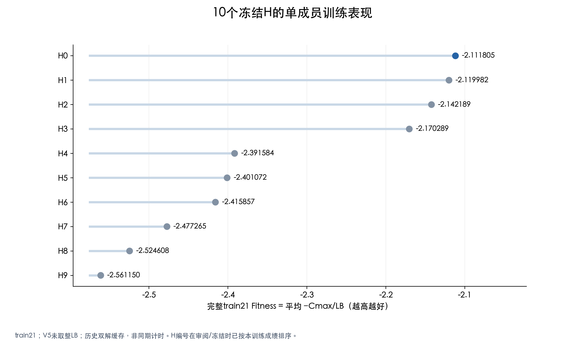

## 02_等权45对分布：45个等权成员对的完整质量覆盖

用途：建议正文。
边界：train21 / seed501；39条原批＋6条独立T30。原批包括T15与认证历史缓存；不能当45对同期耗时实验。

图片：[PNG](/Users/DDXQL/Documents/大学/硕士/代码/FJSP-Heuristic-Research-h-usage-space/reports/组会实验盘点-20261027-v1/图表/02_等权45对分布.png) / [SVG](/Users/DDXQL/Documents/大学/硕士/代码/FJSP-Heuristic-Research-h-usage-space/reports/组会实验盘点-20261027-v1/图表/02_等权45对分布.svg) / [PDF](/Users/DDXQL/Documents/大学/硕士/代码/FJSP-Heuristic-Research-h-usage-space/reports/组会实验盘点-20261027-v1/图表/02_等权45对分布.pdf)

本轮绘图表：[02_等权45对.csv](/Users/DDXQL/Documents/大学/硕士/代码/FJSP-Heuristic-Research-h-usage-space/reports/组会实验盘点-20261027-v1/绘图输入/02_等权45对.csv)

历史来源：[reports/baseline-a-supplemental-T30-seed501-20261024-v1/Composite_pairs_45.csv](/Users/DDXQL/Documents/大学/硕士/代码/FJSP-Heuristic-Research-h-usage-space/reports/baseline-a-supplemental-T30-seed501-20261024-v1/Composite_pairs_45.csv)；[reports/tier2-baseline-a-train21-seed501-20261024-v1/Sources.csv](/Users/DDXQL/Documents/大学/硕士/代码/FJSP-Heuristic-Research-h-usage-space/reports/tier2-baseline-a-train21-seed501-20261024-v1/Sources.csv)；[reports/baseline-a-supplemental-T30-seed501-20261024-v1/Sources.csv](/Users/DDXQL/Documents/大学/硕士/代码/FJSP-Heuristic-Research-h-usage-space/reports/baseline-a-supplemental-T30-seed501-20261024-v1/Sources.csv)

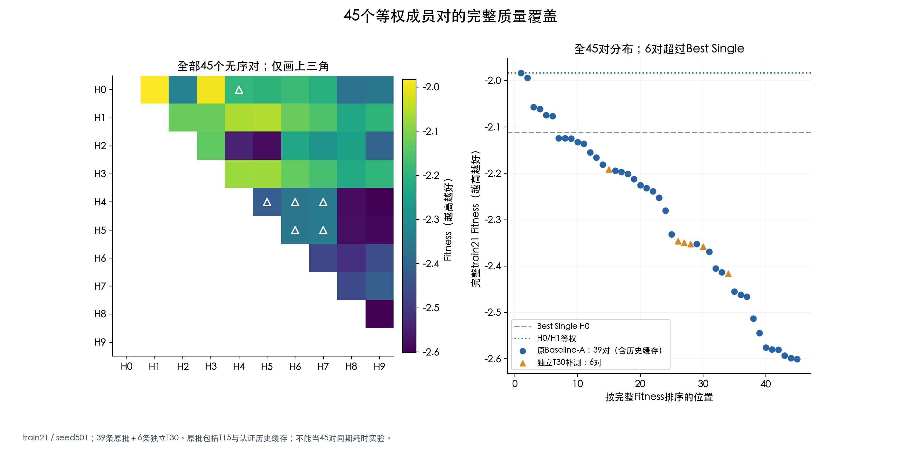

## 03_H01静态权重曲线：H0/H1静态权重网格：21点完整结果

用途：备份页。
边界：train21；16次新增完整评价＋5份手工P0缓存；不是连续权重最优，更不是10H联合搜索。

图片：[PNG](/Users/DDXQL/Documents/大学/硕士/代码/FJSP-Heuristic-Research-h-usage-space/reports/组会实验盘点-20261027-v1/图表/03_H01静态权重曲线.png) / [SVG](/Users/DDXQL/Documents/大学/硕士/代码/FJSP-Heuristic-Research-h-usage-space/reports/组会实验盘点-20261027-v1/图表/03_H01静态权重曲线.svg) / [PDF](/Users/DDXQL/Documents/大学/硕士/代码/FJSP-Heuristic-Research-h-usage-space/reports/组会实验盘点-20261027-v1/图表/03_H01静态权重曲线.pdf)

本轮绘图表：[03_静态权重21点.csv](/Users/DDXQL/Documents/大学/硕士/代码/FJSP-Heuristic-Research-h-usage-space/reports/组会实验盘点-20261027-v1/绘图输入/03_静态权重21点.csv)

历史来源：[reports/a4-evidence-protocol-20261024-v1/H01_grid_21.csv](/Users/DDXQL/Documents/大学/硕士/代码/FJSP-Heuristic-Research-h-usage-space/reports/a4-evidence-protocol-20261024-v1/H01_grid_21.csv)；[runs/h01-state-weight-search-seed501-batch-v3-20261020/Grid_complete.json](/Users/DDXQL/Documents/大学/硕士/代码/FJSP-Heuristic-Research-h-usage-space/runs/h01-state-weight-search-seed501-batch-v3-20261020/Grid_complete.json)

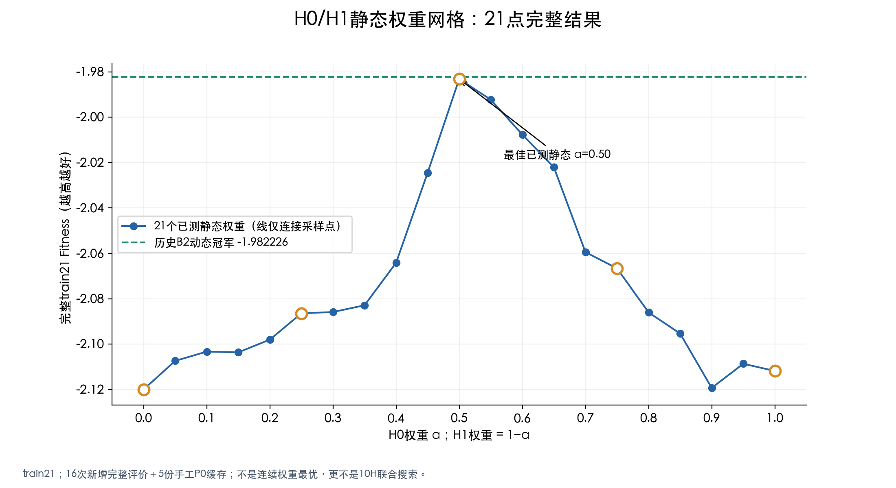

## 04_B1_B2搜索与种群：历史B1/B2搜索轨迹：质量与预算分开解释

用途：建议正文。
边界：原checkpoint尝试顺序；B1九次初始化＋十次演化；B2含强手工P0且另完成21点网格。两者非等先验/等预算消融。

图片：[PNG](/Users/DDXQL/Documents/大学/硕士/代码/FJSP-Heuristic-Research-h-usage-space/reports/组会实验盘点-20261027-v1/图表/04_B1_B2搜索与种群.png) / [SVG](/Users/DDXQL/Documents/大学/硕士/代码/FJSP-Heuristic-Research-h-usage-space/reports/组会实验盘点-20261027-v1/图表/04_B1_B2搜索与种群.svg) / [PDF](/Users/DDXQL/Documents/大学/硕士/代码/FJSP-Heuristic-Research-h-usage-space/reports/组会实验盘点-20261027-v1/图表/04_B1_B2搜索与种群.pdf)

本轮绘图表：[04_搜索全槽轨迹.csv](/Users/DDXQL/Documents/大学/硕士/代码/FJSP-Heuristic-Research-h-usage-space/reports/组会实验盘点-20261027-v1/绘图输入/04_搜索全槽轨迹.csv)；[04_种群成员.csv](/Users/DDXQL/Documents/大学/硕士/代码/FJSP-Heuristic-Research-h-usage-space/reports/组会实验盘点-20261027-v1/绘图输入/04_种群成员.csv)

历史来源：[runs/b1-ns-recovery-B-v1-20261022/r501/B/checkpoint.json](/Users/DDXQL/Documents/大学/硕士/代码/FJSP-Heuristic-Research-h-usage-space/runs/b1-ns-recovery-B-v1-20261022/r501/B/checkpoint.json)；[runs/h01-state-weight-search-seed501-batch-v3-20261020/r501/B/checkpoint.json](/Users/DDXQL/Documents/大学/硕士/代码/FJSP-Heuristic-Research-h-usage-space/runs/h01-state-weight-search-seed501-batch-v3-20261020/r501/B/checkpoint.json)；[reports/b1-ns-recovery-B-execution-20261023/Population_members.csv](/Users/DDXQL/Documents/大学/硕士/代码/FJSP-Heuristic-Research-h-usage-space/reports/b1-ns-recovery-B-execution-20261023/Population_members.csv)；[reports/h01-state-weight-search-seed501-batch-v3-20261020/Population_members.csv](/Users/DDXQL/Documents/大学/硕士/代码/FJSP-Heuristic-Research-h-usage-space/reports/h01-state-weight-search-seed501-batch-v3-20261020/Population_members.csv)

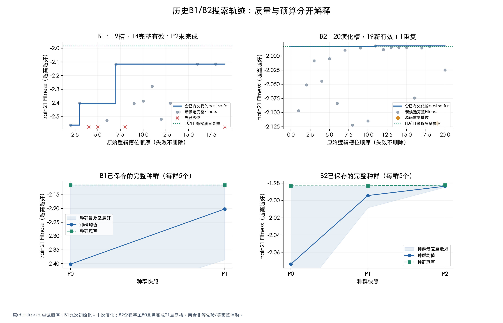

## 05_训练质量比较：固定基线与历史LLM-U：只比较最终策略质量

用途：建议正文。
边界：train21 / V5-LB；B1/B2搜索空间、初始化、查询和缓存投入不同。Oracle仅事后诊断；本图不证明搜索效率或泛化。

图片：[PNG](/Users/DDXQL/Documents/大学/硕士/代码/FJSP-Heuristic-Research-h-usage-space/reports/组会实验盘点-20261027-v1/图表/05_训练质量比较.png) / [SVG](/Users/DDXQL/Documents/大学/硕士/代码/FJSP-Heuristic-Research-h-usage-space/reports/组会实验盘点-20261027-v1/图表/05_训练质量比较.svg) / [PDF](/Users/DDXQL/Documents/大学/硕士/代码/FJSP-Heuristic-Research-h-usage-space/reports/组会实验盘点-20261027-v1/图表/05_训练质量比较.pdf)

本轮绘图表：[05_训练质量参照.csv](/Users/DDXQL/Documents/大学/硕士/代码/FJSP-Heuristic-Research-h-usage-space/reports/组会实验盘点-20261027-v1/绘图输入/05_训练质量参照.csv)

历史来源：[reports/tier2-baseline-a-train21-seed501-20261024-v1/Single_ranking.csv](/Users/DDXQL/Documents/大学/硕士/代码/FJSP-Heuristic-Research-h-usage-space/reports/tier2-baseline-a-train21-seed501-20261024-v1/Single_ranking.csv)；[reports/tier2-baseline-a-train21-seed501-20261024-v1/Oracle.json](/Users/DDXQL/Documents/大学/硕士/代码/FJSP-Heuristic-Research-h-usage-space/reports/tier2-baseline-a-train21-seed501-20261024-v1/Oracle.json)；[reports/b1-ns-recovery-B-execution-20261023/Summary.json](/Users/DDXQL/Documents/大学/硕士/代码/FJSP-Heuristic-Research-h-usage-space/reports/b1-ns-recovery-B-execution-20261023/Summary.json)；[reports/h01-state-weight-search-seed501-batch-v3-20261020/Evidence.json](/Users/DDXQL/Documents/大学/硕士/代码/FJSP-Heuristic-Research-h-usage-space/reports/h01-state-weight-search-seed501-batch-v3-20261020/Evidence.json)

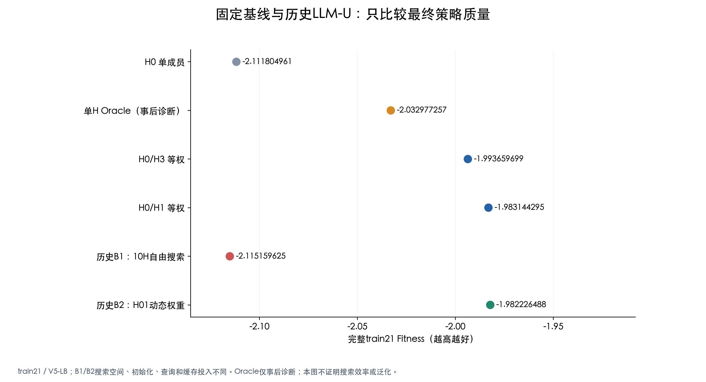

## 06_B2逐实例收益与退化：B2对静态等权：归一化收益与原始Cmax不相同

用途：备份页。
边界：train21；ΔF = 平均[(Cmax等权−CmaxB2)/LB]。B2总Cmax=4050，等权=4047；主指标仍小幅更好。

图片：[PNG](/Users/DDXQL/Documents/大学/硕士/代码/FJSP-Heuristic-Research-h-usage-space/reports/组会实验盘点-20261027-v1/图表/06_B2逐实例收益与退化.png) / [SVG](/Users/DDXQL/Documents/大学/硕士/代码/FJSP-Heuristic-Research-h-usage-space/reports/组会实验盘点-20261027-v1/图表/06_B2逐实例收益与退化.svg) / [PDF](/Users/DDXQL/Documents/大学/硕士/代码/FJSP-Heuristic-Research-h-usage-space/reports/组会实验盘点-20261027-v1/图表/06_B2逐实例收益与退化.pdf)

本轮绘图表：[06_B2逐实例差异.csv](/Users/DDXQL/Documents/大学/硕士/代码/FJSP-Heuristic-Research-h-usage-space/reports/组会实验盘点-20261027-v1/绘图输入/06_B2逐实例差异.csv)

历史来源：[runs/h01-state-weight-search-seed501-batch-v3-20261020/r501/B/checkpoint.json](/Users/DDXQL/Documents/大学/硕士/代码/FJSP-Heuristic-Research-h-usage-space/runs/h01-state-weight-search-seed501-batch-v3-20261020/r501/B/checkpoint.json)；[runs/tier2-baseline-a-train21-seed501-20261024-v1/cache/H0_H1_WS.json](/Users/DDXQL/Documents/大学/硕士/代码/FJSP-Heuristic-Research-h-usage-space/runs/tier2-baseline-a-train21-seed501-20261024-v1/cache/H0_H1_WS.json)

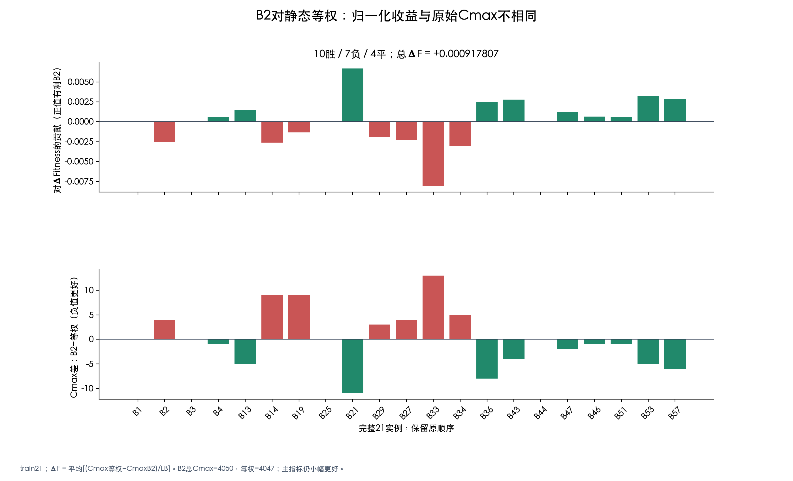

## 07_融合表达与质量：动作不同与排程更好：两种证据必须分开

用途：备份页。
边界：机制：同一批已保存WS轨迹3800状态，离线反事实；质量：V2/V3分别从空排程求解21实例。MAX约98.9%顶端并列。

图片：[PNG](/Users/DDXQL/Documents/大学/硕士/代码/FJSP-Heuristic-Research-h-usage-space/reports/组会实验盘点-20261027-v1/图表/07_融合表达与质量.png) / [SVG](/Users/DDXQL/Documents/大学/硕士/代码/FJSP-Heuristic-Research-h-usage-space/reports/组会实验盘点-20261027-v1/图表/07_融合表达与质量.svg) / [PDF](/Users/DDXQL/Documents/大学/硕士/代码/FJSP-Heuristic-Research-h-usage-space/reports/组会实验盘点-20261027-v1/图表/07_融合表达与质量.pdf)

本轮绘图表：[07_融合机制与质量.csv](/Users/DDXQL/Documents/大学/硕士/代码/FJSP-Heuristic-Research-h-usage-space/reports/组会实验盘点-20261027-v1/绘图输入/07_融合机制与质量.csv)

历史来源：[reports/fusion-v2-train21-seed501-20261023-v2/Ranking.csv](/Users/DDXQL/Documents/大学/硕士/代码/FJSP-Heuristic-Research-h-usage-space/reports/fusion-v2-train21-seed501-20261023-v2/Ranking.csv)；[reports/fusion-v2-train21-seed501-20261023-v2/Common_state_summary.csv](/Users/DDXQL/Documents/大学/硕士/代码/FJSP-Heuristic-Research-h-usage-space/reports/fusion-v2-train21-seed501-20261023-v2/Common_state_summary.csv)；[reports/fusion-v3-borda-train21-seed501-20261024-v1/Ranking.csv](/Users/DDXQL/Documents/大学/硕士/代码/FJSP-Heuristic-Research-h-usage-space/reports/fusion-v3-borda-train21-seed501-20261024-v1/Ranking.csv)；[reports/fusion-v3-borda-train21-seed501-20261024-v1/diagnosis/Common_state_summary.csv](/Users/DDXQL/Documents/大学/硕士/代码/FJSP-Heuristic-Research-h-usage-space/reports/fusion-v3-borda-train21-seed501-20261024-v1/diagnosis/Common_state_summary.csv)

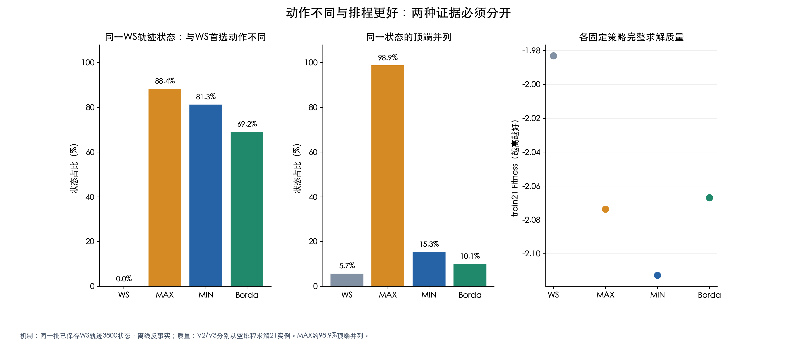

## 08_A4完整与部分路径：A4固定预算静态联合随机搜索：只完成93/300

用途：备份页。
边界：第一轮60/60，第二轮33/60，其余未启动；总最佳来自查询52。保留五项严格墙钟T30隔离，不计算五轮分布。

图片：[PNG](/Users/DDXQL/Documents/大学/硕士/代码/FJSP-Heuristic-Research-h-usage-space/reports/组会实验盘点-20261027-v1/图表/08_A4完整与部分路径.png) / [SVG](/Users/DDXQL/Documents/大学/硕士/代码/FJSP-Heuristic-Research-h-usage-space/reports/组会实验盘点-20261027-v1/图表/08_A4完整与部分路径.svg) / [PDF](/Users/DDXQL/Documents/大学/硕士/代码/FJSP-Heuristic-Research-h-usage-space/reports/组会实验盘点-20261027-v1/图表/08_A4完整与部分路径.pdf)

本轮绘图表：[08_A4部分搜索.csv](/Users/DDXQL/Documents/大学/硕士/代码/FJSP-Heuristic-Research-h-usage-space/reports/组会实验盘点-20261027-v1/绘图输入/08_A4部分搜索.csv)

历史来源：[reports/a4-closeout-20261025-v1/Certified_best_so_far.csv](/Users/DDXQL/Documents/大学/硕士/代码/FJSP-Heuristic-Research-h-usage-space/reports/a4-closeout-20261025-v1/Certified_best_so_far.csv)；[reports/a4-closeout-20261025-v1/Certified_summary.json](/Users/DDXQL/Documents/大学/硕士/代码/FJSP-Heuristic-Research-h-usage-space/reports/a4-closeout-20261025-v1/Certified_summary.json)；[reports/a4-closeout-20261025-v1/Timing_isolation.csv](/Users/DDXQL/Documents/大学/硕士/代码/FJSP-Heuristic-Research-h-usage-space/reports/a4-closeout-20261025-v1/Timing_isolation.csv)

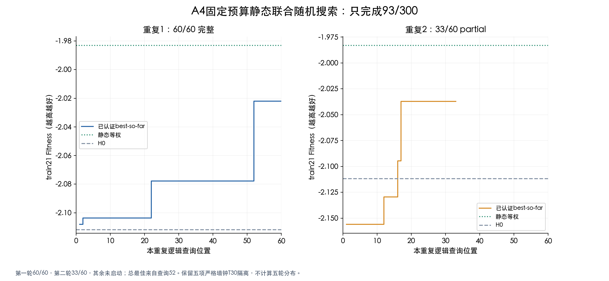

## 09_IND_EVO探索性比较：IND与EVO：两条EVO路径突破，但完整重复不足

用途：备份页。
边界：113/120槽，117尝试；仅重复1双方20/20，其余partial。503/524造成机会不平衡；不是120次独立演化重复。

图片：[PNG](/Users/DDXQL/Documents/大学/硕士/代码/FJSP-Heuristic-Research-h-usage-space/reports/组会实验盘点-20261027-v1/图表/09_IND_EVO探索性比较.png) / [SVG](/Users/DDXQL/Documents/大学/硕士/代码/FJSP-Heuristic-Research-h-usage-space/reports/组会实验盘点-20261027-v1/图表/09_IND_EVO探索性比较.svg) / [PDF](/Users/DDXQL/Documents/大学/硕士/代码/FJSP-Heuristic-Research-h-usage-space/reports/组会实验盘点-20261027-v1/图表/09_IND_EVO探索性比较.pdf)

本轮绘图表：[09_IND_EVO搜索曲线.csv](/Users/DDXQL/Documents/大学/硕士/代码/FJSP-Heuristic-Research-h-usage-space/reports/组会实验盘点-20261027-v1/绘图输入/09_IND_EVO搜索曲线.csv)；[09_IND_EVO完成度.csv](/Users/DDXQL/Documents/大学/硕士/代码/FJSP-Heuristic-Research-h-usage-space/reports/组会实验盘点-20261027-v1/绘图输入/09_IND_EVO完成度.csv)

历史来源：[reports/ind-vs-evo-h01-train21-seed501-20261026-v1/closeout-v1/Completion.csv](/Users/DDXQL/Documents/大学/硕士/代码/FJSP-Heuristic-Research-h-usage-space/reports/ind-vs-evo-h01-train21-seed501-20261026-v1/closeout-v1/Completion.csv)；[reports/ind-vs-evo-h01-train21-seed501-20261026-v1/closeout-v1/Search_curves.csv](/Users/DDXQL/Documents/大学/硕士/代码/FJSP-Heuristic-Research-h-usage-space/reports/ind-vs-evo-h01-train21-seed501-20261026-v1/closeout-v1/Search_curves.csv)

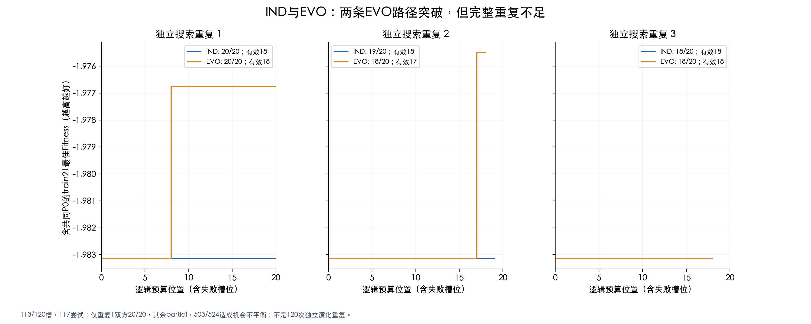

## 10_冻结冠军训练外验证：较好的训练冠军，没有延续为本次跨基准收益

用途：建议正文。
边界：r2_EVO_s16代码冻结后一次评价；Hurink rdata20为跨基准/机器尺度迁移，不是同分布holdout。两数据集分别取均值，不合并。

图片：[PNG](/Users/DDXQL/Documents/大学/硕士/代码/FJSP-Heuristic-Research-h-usage-space/reports/组会实验盘点-20261027-v1/图表/10_冻结冠军训练外验证.png) / [SVG](/Users/DDXQL/Documents/大学/硕士/代码/FJSP-Heuristic-Research-h-usage-space/reports/组会实验盘点-20261027-v1/图表/10_冻结冠军训练外验证.svg) / [PDF](/Users/DDXQL/Documents/大学/硕士/代码/FJSP-Heuristic-Research-h-usage-space/reports/组会实验盘点-20261027-v1/图表/10_冻结冠军训练外验证.pdf)

本轮绘图表：[09_IND_EVO完成度.csv](/Users/DDXQL/Documents/大学/硕士/代码/FJSP-Heuristic-Research-h-usage-space/reports/组会实验盘点-20261027-v1/绘图输入/09_IND_EVO完成度.csv)；[10_冻结冠军训练外逐实例.csv](/Users/DDXQL/Documents/大学/硕士/代码/FJSP-Heuristic-Research-h-usage-space/reports/组会实验盘点-20261027-v1/绘图输入/10_冻结冠军训练外逐实例.csv)

历史来源：[reports/h01-champion-hurink-rdata20-seed501-20261026-v1/Paired_instance_results.csv](/Users/DDXQL/Documents/大学/硕士/代码/FJSP-Heuristic-Research-h-usage-space/reports/h01-champion-hurink-rdata20-seed501-20261026-v1/Paired_instance_results.csv)；[reports/h01-champion-hurink-rdata20-seed501-20261026-v1/Summary.json](/Users/DDXQL/Documents/大学/硕士/代码/FJSP-Heuristic-Research-h-usage-space/reports/h01-champion-hurink-rdata20-seed501-20261026-v1/Summary.json)；[reports/ind-vs-evo-h01-train21-seed501-20261026-v1/closeout-v1/Champion_certification.json](/Users/DDXQL/Documents/大学/硕士/代码/FJSP-Heuristic-Research-h-usage-space/reports/ind-vs-evo-h01-train21-seed501-20261026-v1/closeout-v1/Champion_certification.json)

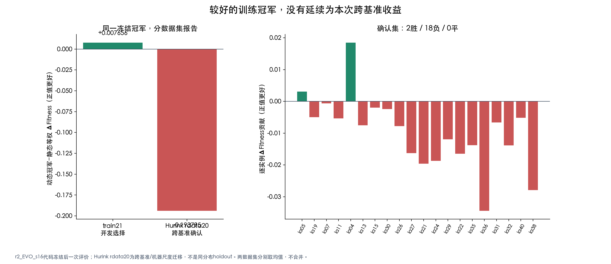

## 11_预定动态规则族：预定简单动态规则：完整列出，不只报告冠军

用途：备份页。
边界：两项独立固定规则研究，不是LLM搜索。18动态权重规则与6算子切换均未超过等权；只约束这两个有限规则族。

图片：[PNG](/Users/DDXQL/Documents/大学/硕士/代码/FJSP-Heuristic-Research-h-usage-space/reports/组会实验盘点-20261027-v1/图表/11_预定动态规则族.png) / [SVG](/Users/DDXQL/Documents/大学/硕士/代码/FJSP-Heuristic-Research-h-usage-space/reports/组会实验盘点-20261027-v1/图表/11_预定动态规则族.svg) / [PDF](/Users/DDXQL/Documents/大学/硕士/代码/FJSP-Heuristic-Research-h-usage-space/reports/组会实验盘点-20261027-v1/图表/11_预定动态规则族.pdf)

本轮绘图表：[11_简单动态规则.csv](/Users/DDXQL/Documents/大学/硕士/代码/FJSP-Heuristic-Research-h-usage-space/reports/组会实验盘点-20261027-v1/绘图输入/11_简单动态规则.csv)；[11_算子进度切换.csv](/Users/DDXQL/Documents/大学/硕士/代码/FJSP-Heuristic-Research-h-usage-space/reports/组会实验盘点-20261027-v1/绘图输入/11_算子进度切换.csv)

历史来源：[reports/h01-progress-step-train21-seed501-20261025-v1/Ranking.csv](/Users/DDXQL/Documents/大学/硕士/代码/FJSP-Heuristic-Research-h-usage-space/reports/h01-progress-step-train21-seed501-20261025-v1/Ranking.csv)；[reports/fusion-v4-progress-switch-seed501-20261024-v1/Ranking.csv](/Users/DDXQL/Documents/大学/硕士/代码/FJSP-Heuristic-Research-h-usage-space/reports/fusion-v4-progress-switch-seed501-20261024-v1/Ranking.csv)

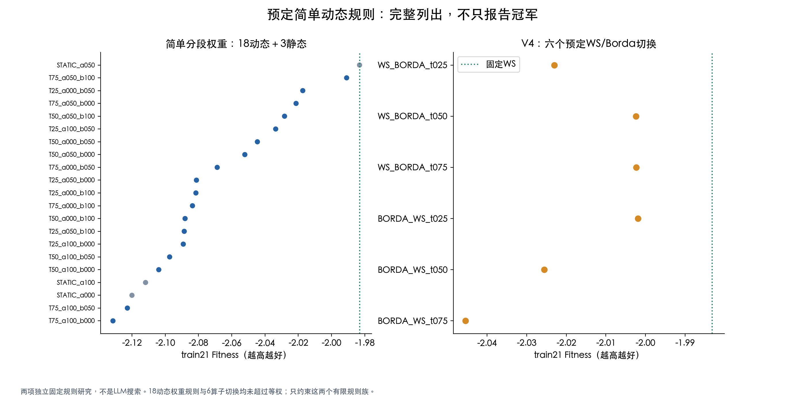

## 12_CROSS成绩反馈分任务：CROSS真实成绩反馈：展示全部有效子代与缺失

用途：备份页。
边界：A=原提示，B=仅加父代成绩与差值。A一项HTTP524未生成，无Fitness；失败不删槽位、不补样本；5任务并非独立多代重复。

图片：[PNG](/Users/DDXQL/Documents/大学/硕士/代码/FJSP-Heuristic-Research-h-usage-space/reports/组会实验盘点-20261027-v1/图表/12_CROSS成绩反馈分任务.png) / [SVG](/Users/DDXQL/Documents/大学/硕士/代码/FJSP-Heuristic-Research-h-usage-space/reports/组会实验盘点-20261027-v1/图表/12_CROSS成绩反馈分任务.svg) / [PDF](/Users/DDXQL/Documents/大学/硕士/代码/FJSP-Heuristic-Research-h-usage-space/reports/组会实验盘点-20261027-v1/图表/12_CROSS成绩反馈分任务.pdf)

本轮绘图表：[12_CROSS反馈候选.csv](/Users/DDXQL/Documents/大学/硕士/代码/FJSP-Heuristic-Research-h-usage-space/reports/组会实验盘点-20261027-v1/绘图输入/12_CROSS反馈候选.csv)

历史来源：[reports/cross-feedback-ab-train21-seed501-v1-20261025/execution-v2/Candidates.csv](/Users/DDXQL/Documents/大学/硕士/代码/FJSP-Heuristic-Research-h-usage-space/reports/cross-feedback-ab-train21-seed501-v1-20261025/execution-v2/Candidates.csv)；[reports/cross-feedback-ab-train21-seed501-v1-20261025/execution-v2/Final_verification.json](/Users/DDXQL/Documents/大学/硕士/代码/FJSP-Heuristic-Research-h-usage-space/reports/cross-feedback-ab-train21-seed501-v1-20261025/execution-v2/Final_verification.json)

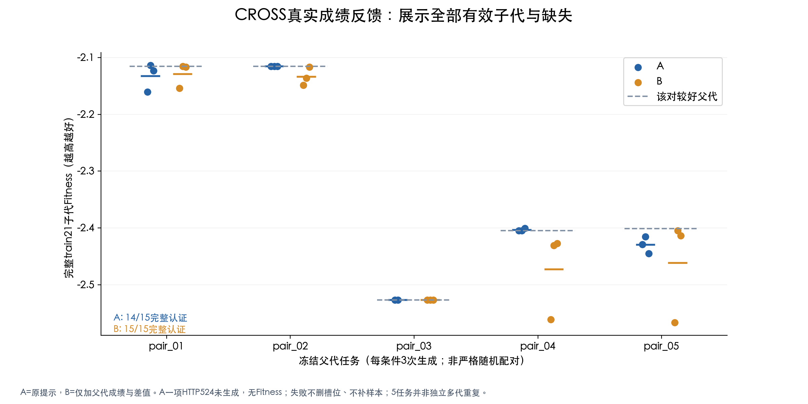
